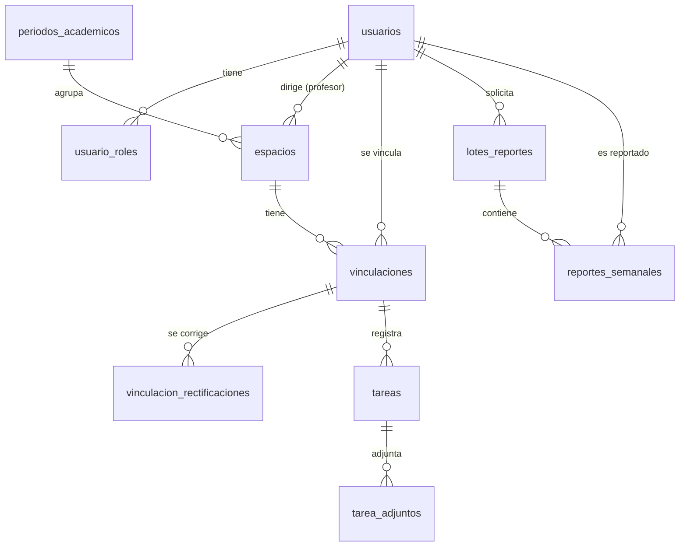

# Paso 4 · Migraciones y esquema de la base de datos

> Rama `paso-a-paso` · paso 4 de 65 · anterior: **Paso 3 · Conexión a PostgreSQL** · siguiente: **Paso 5 · Dockerfile de la API**

---

## 1. Qué se hizo en este paso

Al arrancar, la API crea automáticamente **todas las tablas** del sistema aplicando *migraciones*.

| Archivo | Cambio |
|---|---|
| `backend/internal/basedatos/migraciones/0001_esquema_inicial.sql` | **Nuevo.** El esquema completo: 10 tablas con sus restricciones e índices. |
| `backend/internal/basedatos/basedatos.go` | **Modificado.** Funciones `Migrar` y `aplicarMigracion`; los archivos `.sql` quedan **dentro del ejecutable** con `go:embed`. |
| `backend/cmd/api/main.go` | **Modificado.** Llama a `basedatos.Migrar` después de conectarse. |

Al arrancar con una base de datos vacía se ve en el log:

```json
{"level":"INFO","msg":"migración aplicada","servicio":"api","version":"0001_esquema_inicial"}
```

y la base de datos queda con 11 tablas: las 10 del sistema más `migraciones_aplicadas`. En los arranques siguientes no se vuelve a aplicar nada.

---

## 2. Por qué

### ¿Qué es una migración?

Un archivo con los cambios que hay que aplicar a la **estructura** de la base de datos (crear tablas, columnas, índices) para pasar de una versión del esquema a la siguiente. Es un "control de versiones" para la base de datos: Git guarda la evolución del código y las migraciones la del esquema.

El código y la base de datos deben estar sincronizados: si el código lee una columna, esa columna tiene que existir en **todas** las bases de datos (la de cada integrante, la de GitHub Actions, la de la nube). Hacer ese cambio a mano en cada una es lento y propenso a olvidos. Con migraciones, el cambio queda escrito y se aplica igual en todas partes.

### ¿Por qué todo el esquema en este paso?

Las funcionalidades llegan una por una en los pasos siguientes, pero el **modelo de datos se diseña completo al inicio** porque:
- las tablas dependen unas de otras (una tarea pertenece a una vinculación, que pertenece a un espacio, que pertenece a un período);
- si cada integrante del equipo creara "su" tabla por separado, se producirían conflictos entre migraciones;
- muchas reglas de negocio se garantizan con restricciones en la base de datos (`CHECK`, `UNIQUE`), y es más fácil razonarlas viendo todo el modelo.

### ¿Por qué aplicarlas al arrancar?

Así una base de datos vacía (la de un integrante nuevo, la de CI o la de la nube) queda lista solo con levantar la API, sin comandos manuales.

---

## 3. Explicación detallada

### 3.1 Cómo funciona `Migrar` (`basedatos.go`)

```go
//go:embed migraciones/*.sql
var archivosMigracion embed.FS
```

- `//go:embed` es una **directiva del compilador**: copia los archivos indicados **dentro del ejecutable**. La variable `archivosMigracion` se comporta como un sistema de archivos de solo lectura.
- Ventaja: el binario es autosuficiente. La imagen de Docker (paso 5) no necesita copiar la carpeta `migraciones/`, y es imposible que el binario y sus migraciones no coincidan.
- El comentario debe ir pegado a la variable y sin espacio entre `//` y `go:embed`.

```go
const claveBloqueoMigraciones = 4204_2026

func Migrar(ctx context.Context, pool *pgxpool.Pool, log *slog.Logger) error {
	conn, err := pool.Acquire(ctx)
	...
	defer conn.Release()

	if _, err := conn.Exec(ctx, "SELECT pg_advisory_lock($1)", claveBloqueoMigraciones); err != nil {
		return fmt.Errorf("bloqueando migraciones: %w", err)
	}
	defer conn.Exec(context.WithoutCancel(ctx), "SELECT pg_advisory_unlock($1)", claveBloqueoMigraciones) //nolint:errcheck
```

- `pool.Acquire` toma **una** conexión del pool y la reserva. Es necesario porque el bloqueo de PostgreSQL pertenece a una conexión concreta.
- `pg_advisory_lock(42042026)` es un **bloqueo consultivo**: un candado con un número arbitrario que solo una conexión puede tener a la vez. Si dos instancias de la API arrancan al mismo tiempo (Entrega 3, varias instancias), la segunda espera a que la primera termine de migrar. Sin el candado, ambas intentarían crear las mismas tablas y una fallaría.
- `4204_2026`: los `_` en un número solo sirven para leerlo mejor (el curso es MISW4204). Vale `42042026`.
- El `defer` libera el candado al terminar. `context.WithoutCancel(ctx)` asegura que la liberación se ejecute aunque el contexto original se haya cancelado. El comentario `//nolint:errcheck` le indica al linter (paso 8) que ignorar ese error es intencional: si falla, la conexión se cierra igual y PostgreSQL libera el candado.

```go
	if _, err := conn.Exec(ctx, `CREATE TABLE IF NOT EXISTS migraciones_aplicadas (
		version     TEXT PRIMARY KEY,
		aplicada_en TIMESTAMPTZ NOT NULL DEFAULT now()
	)`); err != nil { ... }
```

- Una tabla de control con las versiones ya aplicadas. `IF NOT EXISTS` la crea solo la primera vez.
- El texto entre comillas invertidas (`` ` ``) es un **string literal crudo**: puede tener varias líneas y no interpreta `\`.

```go
	nombres, err := fs.Glob(archivosMigracion, "migraciones/*.sql")
	...
	sort.Strings(nombres)
	for _, nombre := range nombres {
		if err := aplicarMigracion(ctx, conn.Conn(), nombre, log); err != nil {
			return err
		}
	}
```

- Lista los archivos y los **ordena por nombre**. Por eso los nombres empiezan con un número de 4 dígitos (`0001_`, `0002_`...): el orden alfabético coincide con el orden de aplicación.
- `for _, nombre := range nombres`: el `_` descarta el índice, que no se necesita.

```go
func aplicarMigracion(ctx context.Context, conn *pgx.Conn, nombre string, log *slog.Logger) error {
	version := strings.TrimSuffix(strings.TrimPrefix(nombre, "migraciones/"), ".sql")
	var aplicada bool
	if err := conn.QueryRow(ctx, "SELECT EXISTS (SELECT 1 FROM migraciones_aplicadas WHERE version = $1)", version).Scan(&aplicada); err != nil { ... }
	if aplicada {
		return nil
	}
	sql, err := archivosMigracion.ReadFile(nombre)
	...
	err = pgx.BeginFunc(ctx, conn, func(tx pgx.Tx) error {
		if _, err := tx.Exec(ctx, string(sql)); err != nil {
			return fmt.Errorf("aplicando migración %s: %w", version, err)
		}
		if _, err := tx.Exec(ctx, "INSERT INTO migraciones_aplicadas (version) VALUES ($1)", version); err != nil {
			return fmt.Errorf("registrando migración %s: %w", version, err)
		}
		return nil
	})
	...
	log.Info("migración aplicada", "version", version)
	return nil
}
```

- La versión es el nombre del archivo sin carpeta ni extensión: `0001_esquema_inicial`.
- `$1` es un **parámetro**: el valor viaja aparte del SQL. Nunca se concatena texto en una consulta (eso permitiría inyección SQL).
- `.Scan(&aplicada)` copia el resultado de la consulta en la variable; `&` pasa su dirección para que `Scan` pueda escribir en ella.
- `pgx.BeginFunc` abre una **transacción**, ejecuta la función y:
  - si la función devuelve `nil`, confirma (`COMMIT`);
  - si devuelve un error, revierte (`ROLLBACK`).
  
  Por eso una migración con un error a la mitad **no deja la base de datos a medias**: o se aplica completa y queda registrada, o no se aplica nada. PostgreSQL permite crear tablas dentro de transacciones, lo que no todas las bases de datos admiten.
- Se separó en dos funciones (`Migrar` y `aplicarMigracion`) para que cada una sea corta y fácil de leer.

**Regla de oro:** **nunca se edita una migración que ya se aplicó.** Si `0001` ya corrió en una base de datos, editarla no cambia nada allí (la versión ya está registrada y se salta). Los cambios futuros van en un archivo nuevo, por ejemplo `0002_fecha_limite_creacion.sql`.

### 3.2 El esquema (`0001_esquema_inicial.sql`)



**Decisiones comunes a todas las tablas:**
- **Identificadores UUID** (`UUID PRIMARY KEY DEFAULT gen_random_uuid()`): códigos aleatorios como `6f1c2a8e-1a7d-...` en lugar de números consecutivos. Las URLs de la API (`/tareas/{id}`) no permiten adivinar otros registros probando 1, 2, 3...; además pueden generarse en la aplicación antes de insertar (se aprovecha en el paso 36 con las tareas).
- **`TIMESTAMPTZ`** (fecha y hora con zona horaria) para los momentos (`creado_en`), y **`DATE`** (solo fecha) para los días de calendario (`fecha_inicio`, `semana_inicio`).
- **`TEXT` con `CHECK (x IN (...))`** para los catálogos cerrados (roles, estados): la base de datos rechaza cualquier valor fuera de la lista aunque el código tuviera un error.
- **`REFERENCES`** (llaves foráneas): no se puede crear, por ejemplo, una tarea para una vinculación que no existe.
- **Índices** en las columnas por las que se busca a menudo, para que las consultas no recorran toda la tabla.

**Tabla por tabla:**

| Tabla | Qué guarda | Detalles importantes |
|---|---|---|
| `usuarios` | Personas registradas (RF-02). | Índice **único** sobre `lower(correo)`: `Ana@x.co` y `ana@x.co` son el mismo usuario. Se guarda `password_hash`, nunca la contraseña (paso 12). `activo` para una futura desactivación. |
| `usuario_roles` | Roles de cada usuario (RF-01.3, RN-01: una persona puede tener varios). | Llave primaria `(usuario_id, rol)`: no se repite un rol. `ON DELETE CASCADE`: si se borra el usuario, se borran sus roles. `CHECK` con los 4 roles: administrador, profesor, monitor y asistente_graduado. |
| `periodos_academicos` | Semestres, por ejemplo `2026-20` (RF-03.2). | `codigo` único. `creacion_habilitada` abre o cierra la ventana para crear cursos y proyectos (RN-07). `CHECK (fecha_cierre > fecha_inicio)`. |
| `espacios` | Cursos y proyectos (RF-03). | `tipo` curso o proyecto; `estado` activo o cerrado (RF-03.5); `profesor_id` es el profesor responsable. Índice por profesor porque casi todas las consultas filtran por él. |
| `vinculaciones` | Persona + espacio + rol + horas semanales (RF-04). | `UNIQUE (usuario_id, espacio_id, rol)`: una persona puede estar en el mismo espacio con **roles distintos**, pero no dos veces con el mismo (RF-04.6). `CHECK (horas_semanales > 0)`. Las reglas de 22 h, 12 h, 3 monitorías y 40 % **no** se pueden expresar con `CHECK` porque involucran varias filas; se validan en la aplicación dentro de una transacción con bloqueo (paso 31). |
| `vinculacion_rectificaciones` | Historial de correcciones que hace el administrador (RF-04.5). | Guarda rol y horas anteriores y nuevos, quién corrigió y el motivo. Nada se pierde. |
| `tareas` | Registro semanal de actividades (RF-06). | `CHECK (EXTRACT(ISODOW FROM semana_inicio) = 1)`: la semana se guarda siempre como **su lunes** (RF-08.1). `horas_invertidas INTEGER` (horas enteras, RN-24). `tardia` marca el reporte tardío (RN-32). Índices por vinculación y semana. |
| `tarea_adjuntos` | Metadatos de archivos de evidencia (RF-06.4). | El archivo en sí se guarda fuera de la base de datos (paso 38); aquí solo nombre, ruta, tipo y tamaño. `ON DELETE CASCADE` con la tarea. |
| `lotes_reportes` | Cada ejecución de "generar reportes de la semana" (RF-14.1). | Estado del lote y contadores (total, completados, fallidos) para seguir su avance. |
| `reportes_semanales` | Un reporte PDF por persona y semana (RF-14.2). | Resumen de IA, ruta del PDF, intentos, error, proveedor y modelo de IA usados. `UNIQUE (lote_id, usuario_id)`: un reporte por persona en cada lote. |

---

## 4. Conceptos de Go (y SQL) de este paso

| Concepto | Explicación |
|---|---|
| `//go:embed` | Incluye archivos dentro del ejecutable (`embed.FS`). |
| String crudo | `` `texto` ``: varias líneas, sin secuencias de escape. |
| `_` en números | Separador visual: `4204_2026` es `42042026`. |
| `&variable` | Dirección de la variable, para que otra función escriba en ella (`Scan(&aplicada)`). |
| Transacción | Conjunto de operaciones que se confirman todas o ninguna (`BEGIN`/`COMMIT`/`ROLLBACK`). |
| Parámetros `$1` | Valores separados del SQL; previenen la inyección SQL. |
| Bloqueo consultivo | Candado de PostgreSQL identificado por un número (`pg_advisory_lock`). |
| `//nolint:regla` | Desactiva una advertencia del linter en esa línea, dejando claro que es intencional. |

---

## 5. Cómo comprobarlo

Con un PostgreSQL vacío (como en el paso 3):

```bash
cd backend
POSTGRES_USER=seguimiento POSTGRES_PASSWORD=clave POSTGRES_DB=seguimiento go run ./cmd/api
# log: "migración aplicada" ... "version":"0001_esquema_inicial"
```

Ver las tablas creadas:

```bash
docker exec -it pg psql -U seguimiento -d seguimiento -c '\dt'
docker exec -it pg psql -U seguimiento -d seguimiento -c 'SELECT * FROM migraciones_aplicadas'
```

Detenga y vuelva a arrancar la API: ya no aparece "migración aplicada" porque la versión está registrada.

---

## 6. Pasos para lograr esta versión desde el paso 3

1. Crear la carpeta `backend/internal/basedatos/migraciones/`.
2. Crear `0001_esquema_inicial.sql` con las 10 tablas (ver el archivo en este commit; cada bloque está comentado con los requisitos que atiende).
3. En `backend/internal/basedatos/basedatos.go`:
   - actualizar el comentario del paquete ("...y las migraciones del esquema");
   - agregar los imports `embed`, `io/fs`, `sort`, `strings` y `github.com/jackc/pgx/v5`;
   - declarar `//go:embed migraciones/*.sql` y `var archivosMigracion embed.FS`;
   - agregar la constante `claveBloqueoMigraciones`, `Migrar` y `aplicarMigracion` (sección 3.1).
4. En `backend/cmd/api/main.go`, justo después de `defer db.Close()`:
   ```go
   if err := basedatos.Migrar(ctx, db, log); err != nil {
       return err
   }
   ```
5. Probar contra una base de datos vacía (sección 5) y hacer commit: `git add . && git commit -m "Paso 4: migraciones y esquema de la base de datos"`

Para cambiar el esquema en el futuro: crear `0002_descripcion.sql`; **no editar** `0001`.

---

## 7. Preparación para las próximas entregas

- **El bloqueo consultivo** permite que, en la Entrega 3, varias instancias de la API arranquen a la vez contra la misma base de datos sin pelearse por las migraciones.
- **Las migraciones dentro del binario** hacen que desplegar en una VM o en Cloud Run sea solo "ejecutar la imagen nueva": el esquema se actualiza solo.
- **UUID como identificadores** facilitará escalar horizontalmente: varias instancias pueden generar identificadores sin coordinarse.

---

## 8. Requisitos que atiende

| Requisito | Cómo |
|---|---|
| RNF-04 Persistencia | Tablas para todos los datos del sistema. |
| RNF-06 Consistencia | Restricciones `CHECK`, `UNIQUE` y llaves foráneas. |
| RF-04.6 Vinculaciones independientes | `UNIQUE (usuario_id, espacio_id, rol)`. |
| RF-07.2 Estados de tarea | `CHECK` con abierto, en_desarrollo y finalizado. |
| RF-08.1 Semana de lunes a domingo | `CHECK` de que `semana_inicio` es lunes. |
| Arquitectura §5 Modelo de datos | El esquema completo queda definido. |
