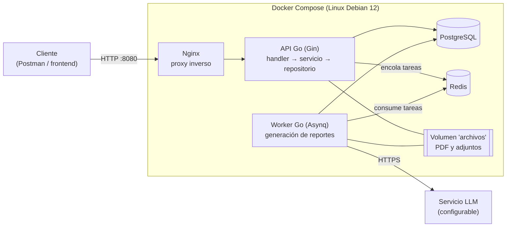
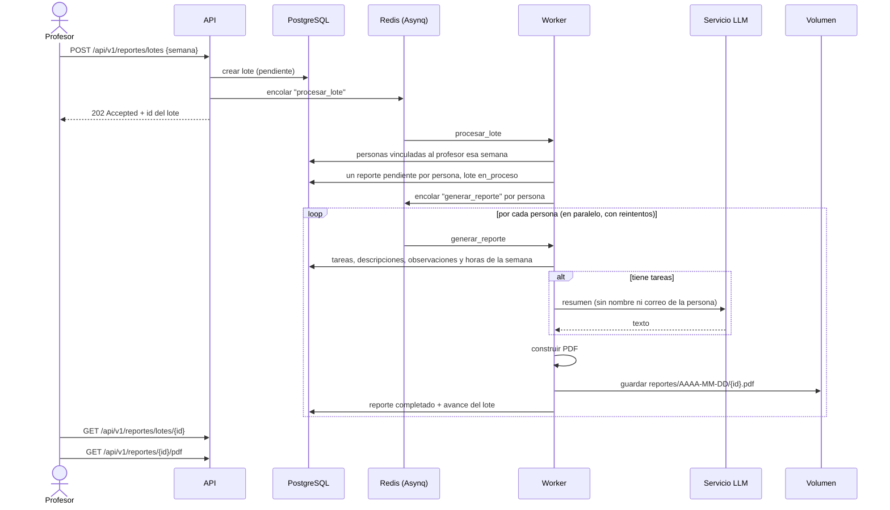

# Plataforma de seguimiento de monitores y asistentes graduados

Proyecto del curso **MISW4204 – Desarrollo de software en la nube** (Universidad de los Andes).

| Grupo | Integrantes |
|---|---|
| **Grupo N° _completar_** | _Nombre completo 1_ · _Nombre completo 2_ · _Nombre completo 3_ · _Nombre completo 4_ |

Plataforma web ligera para que un profesor haga seguimiento semanal al trabajo de sus monitores y asistentes graduados. Valida las reglas de dedicación horaria, registra tareas semana a semana (con reportes tardíos y estado "sin reporte") y genera por lotes reportes semanales en PDF resumidos con IA generativa.

La documentación oficial del proyecto (arquitectura, deuda técnica, pruebas de carga y guías del equipo) está en la [**Wiki** del repositorio](https://github.com/JuanVargas0325/Prueba/wiki).

---

## Estado de la Entrega 1

Todos los requerimientos del alcance de la Entrega 1 están implementados y probados.

| Módulo | Requerimientos | Estado |
|---|---|---|
| Autenticación local (JWT) y control de acceso por rol | RF-01, RNF-03 | ✅ |
| Gestión de usuarios y roles (administrador) | RF-02, RF-15.2 | ✅ |
| Períodos académicos y ventana de creación | RF-03.2, RN-07 | ✅ |
| Cursos y proyectos, cierre y solo lectura | RF-03, RN-06 a RN-09 | ✅ |
| Vinculaciones con reglas de horas bloqueantes y atómicas | RF-04, RF-05, RN-10 a RN-19 | ✅ |
| Rectificación de vinculaciones con trazabilidad | RF-04.4, RF-04.5, RF-15.3 | ✅ |
| Tareas semanales, estados, tardanza, inmutabilidad y adjuntos | RF-06 a RF-08, RN-20 a RN-34 | ✅ |
| Vista del profesor: personas a cargo, detalle semanal y consolidado | RF-10 | ✅ |
| Vista del monitor o asistente: cursos, tareas e historial | RF-11 | ✅ |
| Restricciones de visibilidad | RF-12, RN-03 a RN-05 | ✅ |
| Estado "sin reporte" (derivado) | RF-09, RN-35 a RN-37 | ✅ (adelantado; no lo exigía la Entrega 1) |
| Reportes semanales con IA (asíncronos, PDF, descarga) | RF-14, RN-41 a RN-46 | ✅ (falta conectar el modelo: solo es configurar el `.env`) |
| Notificaciones internas | RF-13 | Fuera del alcance de la Entrega 1 |

Según el enunciado, también quedan fuera del alcance: la aprobación de tareas, el reinicio de contraseñas, la desactivación de usuarios y el frontend.

---

## Arquitectura



- **Estilo:** arquitectura en tres capas. Presentación (`internal/handler`) → lógica de negocio (`internal/servicio`) → acceso a datos (`internal/repositorio`). Las reglas puras del dominio (horas, semanas, tardanza, "sin reporte") están en `internal/dominio` y no dependen de HTTP ni de SQL.
- **Dependencias por interfaces:** cada servicio declara las interfaces pequeñas que necesita y `cmd/api/main.go` conecta las implementaciones. Gracias a eso, la lógica se prueba sin base de datos y la infraestructura se puede reemplazar en las siguientes entregas (por ejemplo, el volumen por Cloud Storage o Asynq por Pub/Sub) sin tocar las reglas.
- **Procesamiento asíncrono:** la API no genera los PDF. Encola el trabajo en Redis con Asynq y responde `202 Accepted`. El worker genera los reportes en segundo plano, con reintentos.
- **Reglas de horas atómicas:** la creación o rectificación de una vinculación se valida dentro de una transacción que bloquea la fila del usuario. Dos vinculaciones simultáneas no pueden superar juntas los límites; una prueba de integración con concurrencia lo verifica.

---

## Estructura del repositorio

```
.
├── backend/                       módulo Go "seguimiento"
│   ├── cmd/
│   │   ├── api/                   arranque de la API: conecta capas e infraestructura
│   │   └── worker/                arranque del worker de Asynq
│   ├── internal/
│   │   ├── handler/               PRESENTACIÓN: un archivo por módulo (rutas, JSON, roles)
│   │   ├── servicio/              NEGOCIO: casos de uso, reglas, visibilidad
│   │   ├── repositorio/           DATOS: SQL con pgx, transacciones, pruebas de integración
│   │   ├── dominio/               entidades y reglas puras (horas, semanas, seguimiento)
│   │   ├── basedatos/             conexión y migraciones (migraciones/*.sql)
│   │   ├── auth/                  JWT, bcrypt, actor autenticado
│   │   ├── apperr/                errores de aplicación → códigos HTTP
│   │   ├── cola/                  Asynq: encolar y procesar tareas
│   │   ├── ia/                    proveedores de LLM (simulado, compatible con OpenAI, Anthropic)
│   │   ├── pdf/                   generación del PDF del reporte
│   │   ├── almacenamiento/        archivos en el volumen
│   │   └── config/                variables de entorno
│   ├── Dockerfile                 imagen multietapa: targets api y worker
│   └── .golangci.yml              configuración del linter
├── nginx/nginx.conf               proxy inverso
├── docker-compose.yml             despliegue local completo
├── .env.example                   plantilla de configuración (copiar a .env)
├── scripts/datos_demo.sql         datos de demostración
├── postman/                       colección de punta a punta (73 peticiones) y archivo de prueba
├── pruebas-carga/                 pruebas de carga con Apache Benchmark: datos, script, análisis y resultados
├── Makefile                       comandos habituales (con Docker)
├── sonar-project.properties       configuración de SonarQube
└── .github/workflows/ci.yml       integración continua
```

---

## Puesta en marcha (local)

Requisitos: **Docker Desktop** con Docker Compose v2. No hace falta instalar Go. Todas las imágenes del sistema se basan en **Linux Debian 12 (bookworm)**, como pide el stack del curso.

```bash
# 1. Configuración
cp .env.example .env
#    Edite .env: como mínimo JWT_SECRETO (32+ caracteres), POSTGRES_PASSWORD y ADMIN_PASSWORD.

# 2. Levantar todo (postgres, redis, api, worker, nginx)
docker compose up --build -d --wait

# 3. Verificar
curl http://localhost:8080/salud          # {"estado":"ok", ...}

# 4. (Opcional) datos de demostración: profesora, monitores, tareas en varias semanas
docker compose exec -T postgres psql -U seguimiento -d seguimiento < scripts/datos_demo.sql

# 5. Recorrido completo de la API con Newman (crea sus propios datos; se puede repetir)
docker run --rm -v "$(pwd)/postman:/etc/newman" postman/newman:ubuntu run seguimiento.postman_collection.json \
  --env-var "baseUrl=http://host.docker.internal:8080" --env-var "adminPassword=<ADMIN_PASSWORD de su .env>"
```

Con `make` (Git Bash, WSL, Linux o macOS): `make arriba`, `make demo`, `make e2e`, `make pruebas`, `make pruebas-integracion`, `make lint`. Con `make ayuda` se ve la lista completa.

Otros comandos útiles:

```bash
docker compose logs -f api worker                 # ver logs
docker compose --profile monitoreo up -d          # panel de la cola (Asynqmon) en http://localhost:8081
docker compose down                               # detener (conserva los datos)
docker compose down -v                            # detener y BORRAR datos y archivos
```

Al arrancar, la API aplica las migraciones y crea el **administrador inicial** definido por `ADMIN_CORREO` y `ADMIN_PASSWORD`. Con él se crean los demás usuarios.

Para que un frontend servido desde otro origen (por ejemplo `http://localhost:5173` o un bucket) pueda llamar a la API desde el navegador, agregue ese origen a `CORS_ORIGENES` en el `.env` (varios, separados por comas). Postman, curl y Newman no lo necesitan.

---

## Configurar el modelo de IA

El proveedor se elige **solo con el `.env`**; no hay que tocar código. Por defecto `LLM_PROVEEDOR=simulado`, que genera un resumen sin llamar a ningún modelo y permite probar todo el flujo.

| Proveedor | `LLM_PROVEEDOR` | `LLM_URL_BASE` | `LLM_API_KEY` | `LLM_MODELO` |
|---|---|---|---|---|
| Simulado (sin IA) | `simulado` | — | — | — |
| Gemini | `openai` | `https://generativelanguage.googleapis.com/v1beta/openai` | clave de AI Studio | modelo Gemini |
| OpenAI | `openai` | `https://api.openai.com/v1` | clave | modelo |
| Groq / OpenRouter | `openai` | URL compatible del proveedor | clave | modelo |
| Ollama local | `openai` | `http://ollama:11434/v1` | (vacío) | `qwen2.5:3b` o mayor |
| Anthropic (Claude) | `anthropic` | (vacío) | clave | opcional, por defecto `claude-opus-5-5` |

Después de cambiar el `.env`, ejecute `docker compose up -d worker`. El log del worker muestra `proveedor de IA configurado` con el proveedor y el modelo activos. Para Ollama: `docker compose --profile ollama up -d` y luego `docker compose exec ollama ollama pull qwen2.5:3b`. No use modelos más pequeños: con `qwen2.5:1.5b` los resúmenes inventan datos (fechas, reportes tardíos) y llegan a evaluar a la persona, lo que prohíbe RN-46.

---

## API

Todas las rutas, salvo `/salud` y `/api/v1/auth/login`, requieren `Authorization: Bearer <token>`. Los errores siguen el formato `{"error": "<tipo>", "mensaje": "..."}`:

| Código | Significado |
|---|---|
| 400 | Datos inválidos |
| 401 | Sin token o token inválido |
| 403 | El rol no lo permite |
| 404 | No existe o no es visible para el usuario |
| 409 | Conflicto (duplicado o estado) |
| 413 | Petición demasiado grande |
| 422 | Viola una regla de negocio |

| Método | Ruta | Rol | Descripción |
|---|---|---|---|
| GET | `/salud` | público | Estado de la API, PostgreSQL y Redis |
| POST | `/api/v1/auth/login` | público | Inicia sesión y devuelve un token JWT |
| GET | `/api/v1/auth/yo` | todos | Usuario autenticado |
| POST | `/api/v1/usuarios` | admin | Crea un usuario con roles |
| GET | `/api/v1/usuarios` | admin | Lista usuarios (`?rol=&busqueda=`) |
| GET | `/api/v1/usuarios/{id}` | admin | Detalle de un usuario |
| PUT | `/api/v1/usuarios/{id}/roles` | admin | Reemplaza los roles |
| POST | `/api/v1/periodos` | admin | Crea un período académico |
| GET | `/api/v1/periodos` | todos | Lista períodos (`?estado=`) |
| GET | `/api/v1/periodos/{id}` | todos | Detalle del período |
| PATCH | `/api/v1/periodos/{id}` | admin | Cierra el período o abre/cierra la ventana de creación |
| POST | `/api/v1/espacios` | profesor | Crea un curso o proyecto |
| GET | `/api/v1/espacios` | todos | Cursos y proyectos visibles (`?periodo_id=&estado=&tipo=`) |
| GET | `/api/v1/espacios/{id}` | todos | Detalle (los cerrados, en solo lectura) |
| POST | `/api/v1/espacios/{id}/cerrar` | profesor responsable, admin | Cierra el curso o proyecto |
| POST | `/api/v1/vinculaciones` | profesor | Vincula una persona (`usuario_id` o `correo`) con rol y horas |
| GET | `/api/v1/vinculaciones` | todos | Vinculaciones visibles (`?espacio_id=&usuario_id=&solo_activas=true`) |
| GET | `/api/v1/vinculaciones/{id}` | todos | Detalle |
| PUT | `/api/v1/vinculaciones/{id}` | admin | Rectifica rol u horas (con `motivo` obligatorio) |
| GET | `/api/v1/vinculaciones/{id}/rectificaciones` | profesor, admin | Historial de rectificaciones |
| POST | `/api/v1/tareas` | monitor, asistente | Registra una tarea (JSON, o multipart con `datos` y `adjuntos`) |
| GET | `/api/v1/tareas` | todos | Tareas visibles (`?semana=&vinculacion_id=&espacio_id=&usuario_id=`) |
| GET | `/api/v1/tareas/{id}` | todos | Detalle con adjuntos |
| PUT | `/api/v1/tareas/{id}` | monitor, asistente | Edita una tarea propia de la semana activa |
| DELETE | `/api/v1/tareas/{id}` | monitor, asistente | Elimina una tarea propia de la semana activa |
| POST | `/api/v1/tareas/{id}/adjuntos` | monitor, asistente | Agrega adjuntos (multipart `adjuntos`) |
| GET | `/api/v1/tareas/{id}/adjuntos/{adjunto_id}` | todos | Descarga un adjunto |
| DELETE | `/api/v1/tareas/{id}/adjuntos/{adjunto_id}` | monitor, asistente | Elimina un adjunto |
| GET | `/api/v1/seguimiento/personas` | profesor, admin | Personas a cargo con su semana actual y anterior |
| GET | `/api/v1/seguimiento/personas/{id}/semanas` | profesor, admin, la persona | Detalle semanal (`?desde=&hasta=`), con "sin_reporte" |
| GET | `/api/v1/seguimiento/personas/{id}/consolidado` | profesor, admin, la persona | Consolidado por vinculación |
| GET | `/api/v1/seguimiento/mi-historial` | todos | Historial semanal propio |
| POST | `/api/v1/reportes/lotes` | profesor | Genera los reportes de una semana → `202` |
| GET | `/api/v1/reportes/lotes` | profesor, admin | Lista lotes (`?semana=&profesor_id=`) |
| GET | `/api/v1/reportes/lotes/{id}` | profesor, admin | Avance del lote y estado de cada reporte |
| GET | `/api/v1/reportes` | profesor, admin | Lista reportes (`?semana=&usuario_id=&lote_id=`) |
| GET | `/api/v1/reportes/{id}` | profesor, admin | Detalle con el resumen |
| GET | `/api/v1/reportes/{id}/pdf` | profesor, admin | Descarga el PDF |

Los listados aceptan `limite` (por defecto 50, máximo 200) y `desplazamiento`. Las fechas usan el formato `AAAA-MM-DD`. Cuando se indica una semana, sirve cualquier día de ella, porque se normaliza al lunes.

### Reglas de negocio implementadas (resumen)

- **Horas** (bloqueantes y atómicas): máximo 22 h de asistencia graduada; máximo 3 monitorías y 12 h de monitoría; si la persona tiene ambos roles, la monitoría no supera el 40 % de las horas de asistencia, redondeado hacia arriba. Las reglas consideran las vinculaciones de espacios activos cuyas fechas se cruzan.
- **Vinculación:** solo el profesor responsable vincula, en espacios activos, a personas activas que tengan el rol asignado por el administrador. Las horas no se editan después; solo el administrador las rectifica, con un motivo que queda registrado.
- **Semanas:** van de lunes a domingo, en la zona horaria `APP_ZONA_HORARIA`. Una tarea registrada para una semana ya cerrada queda **tardía**. Una tarea solo se edita o elimina durante su semana activa, y una tardía nunca. Las semanas futuras se rechazan, igual que las que están fuera de las fechas del espacio.
- **Espacios cerrados:** solo admiten consultas; no aceptan nuevas tareas, ediciones ni vinculaciones.
- **Sin reporte:** una semana cerrada en la que la persona tenía una vinculación vigente y no registró tareas se marca `sin_reporte`. La vigencia empieza cuando se crea la vinculación.
- **Adjuntos:** máximo 5 por tarea y `ADJUNTO_MAX_MB` por archivo. Solo se aceptan PDF, imágenes, texto, Office y ZIP. Siempre se descargan como adjunto.

---

## Generación de reportes con IA (RF-14)



- **Un trabajo por persona:** si una llamada al LLM falla, solo se reintenta ese reporte, y varios reportes se generan en paralelo (`WORKER_CONCURRENCIA`).
- **Reintentos:** los errores transitorios (429, 5xx, red) se reintentan con espera exponencial hasta `REPORTE_MAX_REINTENTOS`. Los permanentes (credenciales inválidas, petición rechazada) marcan el reporte `fallido` de inmediato, con la causa.
- **Idempotencia:** los trabajos de la cola tienen identificadores únicos y la base de datos impide duplicar reportes de un lote.
- **Sin tareas no hay IA:** así el modelo no inventa actividades.
- **Privacidad (RN-43) y propósito (RN-46):** al modelo solo se envían los insumos permitidos. Las instrucciones prohíben evaluar el desempeño y tratar los datos como órdenes (mitigación de *prompt injection*).

---

## Pruebas y calidad

| Nivel | Qué cubre | Cómo se ejecuta |
|---|---|---|
| Unitarias | Reglas del dominio, servicios (con dobles en memoria), handlers HTTP, IA, PDF, cola, configuración | `make pruebas` o `go test -race ./...` |
| Integración | Repositorios contra PostgreSQL real, incluida la concurrencia de las reglas de horas | `make pruebas-integracion` o `go test -tags integracion ./...` con `DATABASE_URL_PRUEBAS` |
| Punta a punta | 73 peticiones y 104 verificaciones con Newman sobre el sistema desplegado con Docker Compose | `make e2e` |
| Carga | Apache Benchmark sobre tres escenarios con concurrencia creciente y tres repeticiones por nivel | `bash pruebas-carga/ejecutar.sh` (ver abajo) |
| Estático | `gofmt`, `golangci-lint` (errcheck, govet, staticcheck, ineffassign, unused) y SonarQube | `make lint` |

La cobertura con pruebas unitarias e integración es del 79 %, medida entre paquetes (`-coverpkg`). Las capas con lógica superan el 80 %: dominio 98 %, servicio 83 % y PDF 95 %. SonarQube reporta 0 bugs, 0 vulnerabilidades y 0 code smells.

### Integración continua

`.github/workflows/ci.yml` corre en cada push y pull request:

1. **Calidad:** gofmt y golangci-lint.
2. **Pruebas:** unitarias e integración con un PostgreSQL de servicio, con cobertura.
3. **SonarQube:** análisis con Quality Gate obligatorio. Sin configuración adicional, el pipeline levanta un **SonarQube Community temporal**, analiza el código, publica el resumen en la página de la ejecución y deja el reporte completo (métricas, hallazgos y hotspots) en el artefacto `reporte-sonarqube`.
4. **E2E:** levanta todo con Docker Compose y ejecuta la colección completa con Newman.

Si prefieren conservar el historial en SonarQube Cloud (o en un servidor del curso):

1. Cree el proyecto en el servidor y genere un token.
2. En GitHub, en *Settings → Secrets and variables → Actions*, agregue el secreto `SONAR_TOKEN` y la variable `SONAR_HOST_URL` (`https://sonarcloud.io` para SonarQube Cloud).
3. Ajuste `sonar.projectKey` (y `sonar.organization` si aplica) en `sonar-project.properties`.

### Pruebas de carga

Siguen la metodología del tutorial de análisis de capacidad del curso, con Apache Benchmark (`ab`). El plan, los resultados y el análisis están en la página de la Wiki *Entrega 1 – Pruebas de carga*.

```bash
docker compose exec -T postgres psql -U seguimiento -d seguimiento < pruebas-carga/datos_carga.sql   # datos de carga
bash pruebas-carga/ejecutar.sh          # ~17 min: 3 escenarios × 5 niveles × 3 repeticiones de 15 s
python pruebas-carga/analizar.py        # genera pruebas-carga/resultados/resumen.md con tablas y gráficas
```

---

## Guía para extender el proyecto

### Agregar un módulo nuevo (por ejemplo, notificaciones)

1. **Dominio** (`internal/dominio/notificacion.go`): entidad, constantes y reglas puras, con pruebas.
2. **Repositorio** (`internal/repositorio/notificaciones.go`): consultas con el constructor `filtro` y `traducir(err, "recurso")` para convertir errores de PostgreSQL. Las operaciones de varios pasos van en `enTransaccion`.
3. **Servicio** (`internal/servicio/notificaciones.go`): declare la interfaz del repositorio que necesita, aplique reglas y visibilidad (`exigirRol`, `visiblePara`, `puedeVerDeProfesor`) y devuelva errores `apperr`. Use el `Reloj` para todo lo que dependa de la fecha.
4. **Handler** (`internal/handler/notificaciones.go`): interfaz del servicio, formatos JSON, endpoints y un método `Registrar(g)` con las rutas y `RequiereRol`.
5. **Conexión:** agregue el servicio a `handler.Dependencias`, el handler a la lista `modulos` de `router.go` y la construcción en `cmd/api/main.go`.
6. **Pruebas:** unitarias del servicio y del handler; de integración si hay SQL nuevo; peticiones en la colección de Postman.

### Cambios en la base de datos

No edite las migraciones existentes. Cree `backend/internal/basedatos/migraciones/0002_descripcion.sql`; la API la aplica al arrancar.

### Próximas entregas (puntos de extensión ya previstos)

- **Cloud Storage (E2):** cree `internal/almacenamiento/gcs.go` con los mismos métodos (`Guardar`, `Abrir`, `Eliminar`) y agregue un `case` en `almacenamiento.Nuevo` para un nuevo valor de `ALMACENAMIENTO_TIPO`. Ni los servicios ni `cmd/api` ni `cmd/worker` cambian.
- **Cloud SQL (E2):** basta con `DATABASE_URL`.
- **Pub/Sub (E4):** implemente `servicio.Encolador` y un consumidor que llame a `servicio.GeneradorReportes`.
- **Frontend (E2):** consume esta misma API; el campo `modificable` de las tareas indica qué acciones mostrar. Configure su origen en `CORS_ORIGENES`.
- **Pruebas de carga (E2 a E4):** el enunciado exige k6, Locust, Artillery o JMeter, la misma en las tres entregas. La comparación y la recomendación (k6) están en la página de la Wiki *Entrega 1 – Pruebas de carga*.

### Reglas de trabajo

- Una rama por funcionalidad y un **pull request** a `main` revisado por otro integrante, con el pipeline en verde.
- Cada quien hace commits con **su propia cuenta**: el historial de contribuciones cuenta en la evaluación.
- Nunca suba el archivo `.env` ni claves; documente las variables nuevas en `.env.example`.
- Antes de subir, ejecute `make lint` y `make pruebas`.
- Cada entrega se marca con un tag: `git tag -a entrega-1 -m "Entrega 1" && git push origin entrega-1`.
