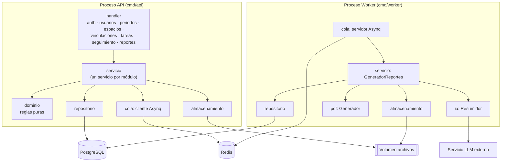
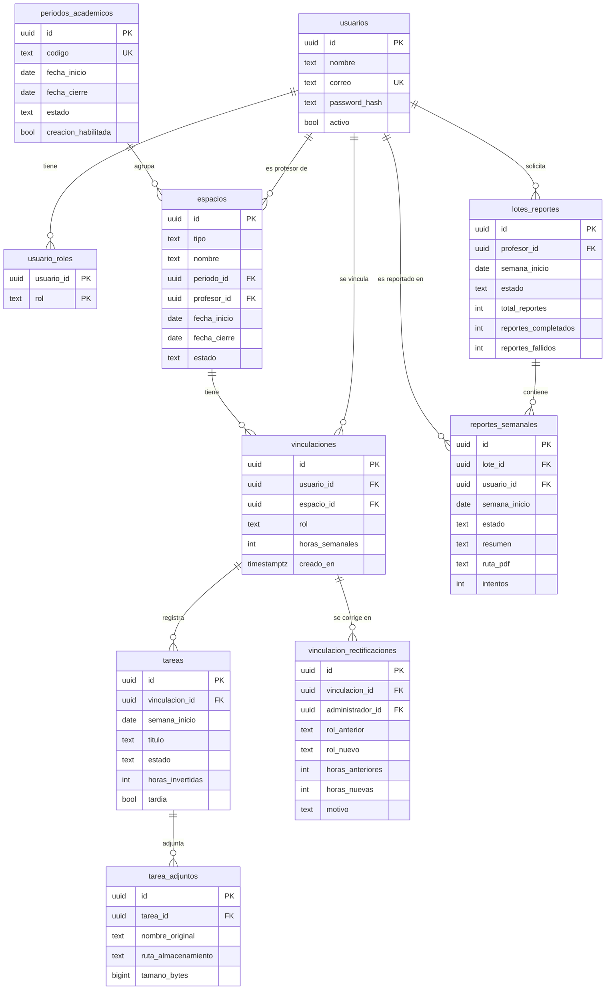
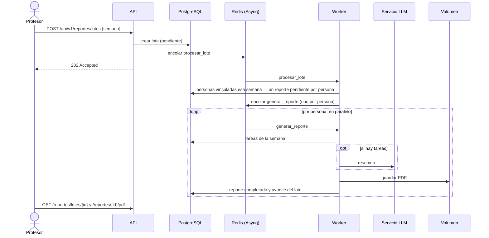

# Entrega 1 – Arquitectura de la solución

> **Grupo N° _completar_** · _Integrantes_
>
> Borrador. Las secciones marcadas con ✏️ deben completarse o revisarse en equipo. Cada diagrama debe ir acompañado de texto que explique su propósito y las decisiones que refleja (lineamientos, secciones 5, 6 y 9).

## 1. Problema de negocio y objetivo ✏️

_Tomar del documento de visión de arquitectura del equipo. Mencionar también el componente de reportes semanales generados con IA (RF-14)._

## 2. Estilo de arquitectura ✏️

Se adoptó una **arquitectura en tres capas** (presentación, lógica de negocio y acceso a datos).

_Completar con la comparación de alternativas (MVC, hexagonal, microservicios), el motivo de la elección, sus ventajas, sus desventajas y compromisos (por ejemplo, el riesgo de que la lógica se filtre a los handlers) y la tabla de atributos de calidad._

Correspondencia de las capas con el código:

| Capa | Paquete | Responsabilidad |
|---|---|---|
| Presentación | `internal/handler` | Un archivo por módulo: rutas REST (Gin), formatos JSON, validación de entrada, autenticación JWT, verificación del rol, traducción de errores a HTTP |
| Lógica de negocio | `internal/servicio` | Casos de uso por módulo, visibilidad por profesor/usuario (RN-03 a RN-05), orquestación de la generación de reportes |
| Acceso a datos | `internal/repositorio` | Consultas SQL sobre PostgreSQL (pgx), transacciones, bloqueos para reglas concurrentes |
| Dominio | `internal/dominio` | Entidades y reglas puras: carga horaria, semanas, tardanza, modificabilidad, seguimiento y "sin reporte" |
| Transversales | `apperr`, `auth`, `config` | Errores de aplicación, seguridad, configuración |
| Infraestructura | `cola`, `ia`, `pdf`, `almacenamiento` | Asynq/Redis, proveedores de LLM, generación de PDF, archivos en volumen |

La capa de servicio depende de **interfaces** (por ejemplo `RepositorioReportes`, `Encolador`, `Almacenamiento`, `ia.Resumidor`), no de implementaciones concretas. Esto permite probar la lógica de negocio sin base de datos ni Redis, y cambiar la infraestructura en las siguientes entregas (por ejemplo, el volumen por Cloud Storage) sin tocar las reglas.

## 3. Modelo de componentes ✏️

- La **API** atiende todas las operaciones síncronas. Cada módulo de negocio tiene un handler, un servicio y un repositorio, y los handlers se registran en el router con un método `Registrar`, de modo que agregar un módulo no modifica los existentes.
- El **worker** es un proceso separado porque la generación con IA es lenta y depende de un servicio externo: no debe bloquear las peticiones HTTP, puede reintentar sin afectar al usuario y puede escalar de forma independiente en las siguientes entregas.
- **API y worker comparten el código** de la capa de servicio y de datos (mismo módulo Go, dos ejecutables), así que las reglas son las mismas en ambos.
- ✏️ _Complementar con la justificación del equipo._

## 4. Modelo de despliegue ✏️

_Reemplazar por el diagrama de despliegue final del equipo._ Elementos que debe mostrar:

- Nodo anfitrión Linux con Docker Engine y la red interna de Docker Compose.
- Contenedores: `nginx` (único puerto expuesto, 8080→80), `api` (8080 interno), `worker`, `postgres` (5432 interno), `redis` (6379 interno).
- Volúmenes: `datos-postgres`, `datos-redis` y `archivos` (montado en `/data` en **api** y **worker**: el worker escribe los PDF y la API los sirve).
- Dependencia externa: el servicio LLM (HTTPS), salvo que se use Ollama como contenedor.
- Orden de arranque: postgres y redis saludables → api (aplica migraciones) → worker y nginx.

## 5. Modelo de datos

Decisiones del modelo:

- **Roles globales y rol por vinculación:** `usuario_roles` define qué puede hacer cada usuario en la plataforma (RF-01.3). `vinculaciones.rol` define si la persona es monitor o asistente graduado **en ese curso o proyecto** (RN-02). Así una persona puede ser monitora en un curso y asistente en un proyecto.
- **Profesor responsable:** se obtiene del espacio (`espacios.profesor_id`) y no se duplica en la vinculación (RN-11).
- **Semana:** `tareas.semana_inicio` guarda siempre el lunes. Una restricción `CHECK` lo garantiza, y `dominio.InicioSemana` lo calcula (RN-29).
- **Catálogos cerrados** con `CHECK` en roles, estados de tarea (RN-27, RN-28), tipos de espacio (RN-06) y estados de lote y reporte.
- **Archivos fuera de la base de datos:** `tarea_adjuntos` y `reportes_semanales` guardan solo la ruta dentro del almacenamiento.
- Las reglas de horas (RN-14 a RN-19) **no** se pueden expresar con restricciones de una sola fila, porque dependen de varias vinculaciones. El repositorio abre una transacción, **bloquea la fila del usuario** (`SELECT ... FOR UPDATE`), lee sus vinculaciones simultáneas y ejecuta el validador que le entrega el servicio (`dominio.ValidarCargaHoraria`) antes de insertar o rectificar. Así, dos vinculaciones creadas al mismo tiempo no pueden superar juntas los límites. Una prueba de integración con concurrencia lo verifica. Las reglas siguen en el dominio y la atomicidad la garantiza la capa de datos.
- **Simultaneidad:** se consideran las vinculaciones en espacios **activos** cuyas fechas se cruzan con las del espacio de la nueva vinculación. Las de espacios cerrados ya no suman carga.
- **Trazabilidad de rectificaciones (RF-04.5):** cada corrección guarda el valor anterior, el nuevo, el administrador y el motivo.
- **"Sin reporte" derivado (RN-36):** no se guarda. Se calcula al consultar a partir de las vinculaciones vigentes y las tareas de cada semana. La vigencia empieza en la fecha de creación de la vinculación.

## 6. Flujo de procesamiento asíncrono: reportes con IA

1. **Solicitud (API).** El profesor indica cualquier fecha de la semana, que se normaliza al lunes. Se valida que no sea una semana futura y que no haya otro lote en curso para esa semana (`409`). Se crea el lote, se encola y se responde `202 Accepted` sin esperar al modelo.
2. **Reparto (worker, `procesar_lote`).** Se buscan las personas con vinculaciones en cursos o proyectos del profesor vigentes durante la semana. Se crea un reporte `pendiente` por persona (idempotente) y se encola un trabajo `generar_reporte` por cada una.
3. **Generación (worker, `generar_reporte`).** Se leen las tareas de la semana. Si hay tareas, se pide el resumen al LLM y si no, se usa un texto fijo sin llamar al modelo. Se genera el PDF, se guarda en `reportes/AAAA-MM-DD/<id>.pdf` y se marca el reporte como `completado`. En la misma transacción se actualiza el avance del lote.
4. **Fallos.** Los errores transitorios (429, 5xx, red) se reintentan con espera exponencial hasta `REPORTE_MAX_REINTENTOS`. Los permanentes (credenciales inválidas, petición rechazada) o el último intento marcan el reporte como `fallido` con su causa. El lote termina `completado`, `completado_con_errores` o `fallido`.
5. **Consulta y descarga (API).** El profesor consulta el avance y descarga el PDF. Solo el profesor dueño o un administrador pueden hacerlo.

Configuración relevante: `WORKER_CONCURRENCIA` (reportes en paralelo), `REPORTE_MAX_REINTENTOS`, `REPORTE_TIMEOUT`, `LLM_*` (proveedor y modelo).

## 7. Integración con el modelo de IA

- El proveedor se selecciona con `LLM_PROVEEDOR`: `simulado`, `openai` (cualquier API compatible: OpenAI, Gemini, Groq, Ollama…) o `anthropic`. Todos implementan la interfaz `ia.Resumidor`, así que cambiar de proveedor no afecta la lógica de negocio.
- **Insumos (RN-43):** solo títulos, descripciones, estados, observaciones y horas reportadas. Por privacidad no se envían el nombre, el correo ni las horas contratadas.
- **Propósito (RN-46):** las instrucciones del sistema piden sintetizar sin evaluar el desempeño. Los datos van delimitados en `<datos_semana>` y se indica al modelo que no los trate como instrucciones (mitigación de *prompt injection*).
- ✏️ _Indicar el proveedor y el modelo elegidos por el equipo y la justificación (costo, nivel gratuito, latencia, privacidad)._

## 8. Integración con servicios del proveedor de nube

No aplica en la Entrega 1: el despliegue es local con Docker Compose. Para la Entrega 2 está previsto reemplazar PostgreSQL local por Cloud SQL y el volumen de archivos por Cloud Storage. La interfaz `servicio.Almacenamiento` permite añadir esa implementación sin cambiar la lógica de negocio.

## 9. Reglas temporales y visibilidad

- Las semanas van de lunes a domingo en la zona `APP_ZONA_HORARIA` (por defecto America/Bogota). Un `Reloj` inyectado en los servicios permite probar estas reglas con fechas fijas.
- **Tardanza (RN-32):** una tarea creada para una semana anterior a la actual se marca tardía al crearse. **Inmutabilidad (RN-33, RN-34):** solo se edita o elimina durante su semana activa y nunca si es tardía. El repositorio también impide actualizar o eliminar tareas tardías, como defensa adicional.
- **Visibilidad (RF-12):** los listados se filtran por el actor (`VisiblePara`). El profesor ve sus espacios y sus personas; el monitor o asistente, sus registros; el administrador, todo. Si un recurso no es visible se responde 404, para no revelar que existe.

## 10. Seguridad

- Autenticación local con contraseñas bcrypt y tokens JWT (HS256) con expiración. El login no revela si el correo existe: responde el mismo error y tarda lo mismo.
- Control de acceso por rol en la capa de presentación y verificación de pertenencia (profesor dueño, persona dueña) en la capa de servicio.
- Entrada estricta: el JSON rechaza campos desconocidos; los identificadores se validan como UUID; los textos tienen longitudes máximas.
- Adjuntos: lista blanca de extensiones, tamaño máximo por archivo y por petición, nombres saneados, descarga siempre como adjunto con `X-Content-Type-Options: nosniff`.
- Solo Nginx expone un puerto. La API, PostgreSQL y Redis quedan en la red interna de Docker.
- Secretos en variables de entorno (`.env`, fuera del repositorio). Los contenedores corren con un usuario sin privilegios.
