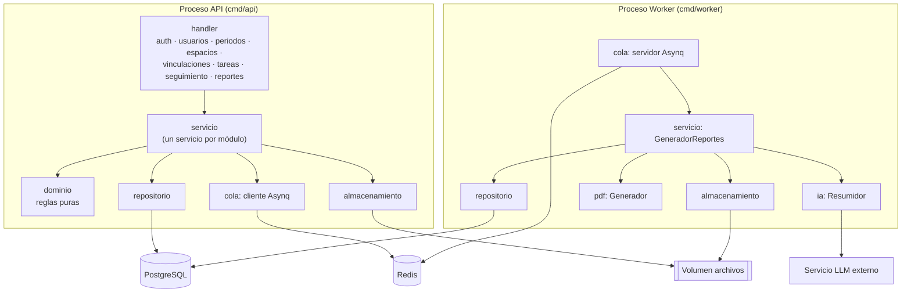
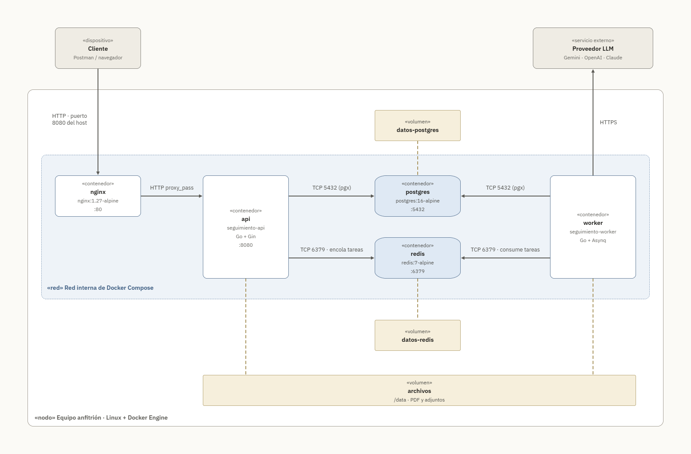
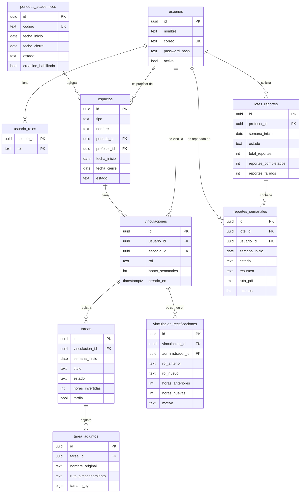
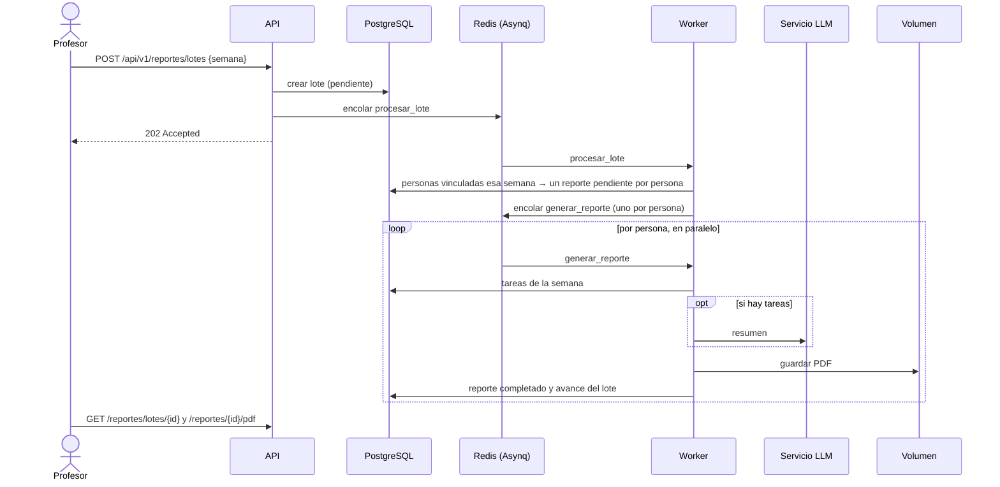

# Entrega 1 – Arquitectura de la solución

> **Grupo N° _completar_** · _Integrantes_
>
> Cada diagrama va acompañado de texto que explica su propósito y las decisiones que refleja (lineamientos, secciones 5, 6 y 9). Las notas marcadas con ✏️ son para que el equipo las revise antes de la entrega.

## 1. Problema de negocio y objetivo

El seguimiento de las actividades de monitores y asistentes graduados exige gestionar vinculaciones, responsabilidades, tareas, horas dedicadas y reportes semanales. Esa información debe estar organizada y disponible para los profesores responsables, teniendo en cuenta que una misma persona puede participar en varios espacios y con distintos roles.

El proceso debe cumplir reglas que no pueden depender del control manual: límites de horas semanales para asistentes graduados y monitores, restricciones sobre la cantidad de vinculaciones y condiciones cuando una persona desempeña ambos roles. También hay que controlar los períodos académicos, las semanas de trabajo, el cierre de los reportes y los permisos de acceso a la información. Sin una plataforma centralizada que aplique estas reglas de forma consistente, aparecen errores en el registro de horas, se pierde trazabilidad y el seguimiento oportuno se dificulta.

**Objetivo.** Construir una plataforma web para gestionar y hacer el seguimiento operativo de monitores y asistentes graduados vinculados a cursos y proyectos. La plataforma:

- administra los períodos y espacios académicos, y las vinculaciones de las personas según su rol;
- registra semanalmente las actividades, las horas dedicadas y la información complementaria de cada tarea;
- automatiza las reglas de carga horaria, vinculación y manejo de períodos y semanas, sin que dependan de los usuarios;
- garantiza que cada usuario acceda solo a la información que le corresponde y que los registros mantengan su trazabilidad;
- genera por lotes, con IA generativa, un reporte semanal en PDF por persona que sintetiza el trabajo reportado, sin evaluar su desempeño (RF-14).

La solución se diseña modular y mantenible, priorizando la lógica de negocio, para evolucionar en las siguientes entregas (frontend, despliegue en la nube, escalamiento y servicios gestionados) sin limitar su crecimiento.

## 2. Estilo de arquitectura

Se analizaron cuatro alternativas considerando el alcance de la primera versión, los atributos de calidad prioritarios y la complejidad del dominio:

| Alternativa | Ventajas | Por qué no se eligió |
|---|---|---|
| MVC tradicional | Simple y conocido | Orientado a aplicaciones con vistas; en una API las reglas tienden a quedar en los controladores, y aquí las reglas son el núcleo del sistema. |
| Hexagonal (puertos y adaptadores) | Aísla por completo el dominio de la infraestructura | Más abstracciones y adaptadores de los que justifica la primera versión. De ella se toma la idea de depender de interfaces. |
| Microservicios | Escalado y despliegue independientes por servicio | El dominio es pequeño y muy cohesionado (las reglas de horas cruzan usuarios, espacios y vinculaciones); separarlo añadiría red, consistencia distribuida y operación sin beneficio en esta etapa. |
| **Tres capas** (elegida) | Separa presentación, negocio y datos con bajo costo | — |

Se eligió una **arquitectura en tres capas**: presentación (API REST), lógica de negocio (casos de uso y reglas) y acceso a datos (persistencia). Esta separación evita que las reglas de negocio dependan de la interfaz o de la base de datos, facilita las pruebas y permite que cada capa evolucione por separado. Como complemento, las reglas puras viven en un paquete de dominio sin dependencias, y la capa de servicio depende de interfaces (idea tomada de la arquitectura hexagonal).

**Responsabilidades de cada capa**

- **Presentación:** punto de entrada de las peticiones, expone la API REST, valida la entrada, autentica (JWT), verifica el rol y construye las respuestas.
- **Lógica de negocio:** casos de uso, reglas y validaciones del dominio, coordinación entre componentes y decisión sobre qué operaciones están permitidas según el usuario y el contexto (visibilidad).
- **Acceso a datos:** persistencia, consultas y transacciones; encapsula la interacción con PostgreSQL.

**Atributos de calidad**

| Atributo | Contribución del estilo | Nivel |
|---|---|---|
| Consistencia del negocio | Las reglas se centralizan en el dominio y la capa de servicio; las que dependen de varios registros se validan dentro de una transacción con bloqueo. | Alto |
| Mantenibilidad | Cada capa y cada módulo tienen límites claros; un cambio en la persistencia no afecta las reglas. | Alto |
| Testabilidad | La lógica se prueba sin base de datos gracias a las interfaces; la capa de datos tiene pruebas de integración propias. | Alto |
| Modularidad | Un archivo por módulo en cada capa; agregar un módulo no modifica los existentes. | Alto |
| Escalabilidad | La separación, y el worker independiente, facilitan escalar después, pero el estilo por sí solo no la garantiza. | Medio |

**Desventajas y compromisos asumidos**

- Riesgo de que la lógica se filtre a los handlers o a las consultas SQL. Se mitiga con la convención de que el handler solo traduce HTTP y el repositorio solo persiste; las reglas viven en dominio y servicio.
- Más archivos y algo de código repetitivo (interfaces, conversiones a JSON) que en una aplicación sin capas.
- Una sola unidad de despliegue para la API: escalarla escala todos los módulos a la vez. Es aceptable para el tamaño del dominio y se revisa con las pruebas de carga.

Correspondencia de las capas con el código:

| Capa | Paquete | Responsabilidad |
|---|---|---|
| Presentación | `internal/handler` | Un archivo por módulo: rutas REST (Gin), formatos JSON, validación de entrada, autenticación JWT, verificación del rol, traducción de errores a HTTP |
| Lógica de negocio | `internal/servicio` | Casos de uso por módulo, visibilidad por profesor/usuario (RN-03 a RN-05), orquestación de la generación de reportes |
| Acceso a datos | `internal/repositorio` | Consultas SQL sobre PostgreSQL (pgx), transacciones, bloqueos para reglas concurrentes |
| Dominio | `internal/dominio` | Entidades y reglas puras: carga horaria, semanas, tardanza, modificabilidad, seguimiento y "sin reporte" |
| Transversales | `apperr`, `auth`, `config` | Errores de aplicación, seguridad, configuración |
| Infraestructura | `cola`, `ia`, `pdf`, `almacenamiento` | Asynq/Redis, proveedores de LLM, generación de PDF, archivos en volumen |

La capa de servicio depende de **interfaces** (por ejemplo `RepositorioReportes`, `Encolador`, `Almacenamiento`, `ia.Resumidor`), no de implementaciones concretas. Esto permite probar la lógica de negocio sin base de datos ni Redis, y cambiar la infraestructura en las siguientes entregas (por ejemplo, el volumen por Cloud Storage) sin tocar las reglas.

## 3. Modelo de componentes

- La **API** atiende todas las operaciones síncronas. Cada módulo de negocio tiene un handler, un servicio y un repositorio, y los handlers se registran en el router con un método `Registrar`, de modo que agregar un módulo no modifica los existentes.
- El **worker** es un proceso separado porque la generación con IA es lenta y depende de un servicio externo: no debe bloquear las peticiones HTTP, puede reintentar sin afectar al usuario y puede escalar de forma independiente en las siguientes entregas.
- **API y worker comparten el código** de la capa de servicio y de datos (mismo módulo Go, dos ejecutables), así que las reglas son las mismas en ambos.

## 4. Modelo de despliegue

*Figura: despliegue local con Docker Compose sobre un nodo Linux (Debian 12).*

La solución se despliega en un solo nodo Linux con Docker Compose, que crea una red interna donde se comunican cinco contenedores basados en Debian 12. **Nginx** es el único servicio expuesto (puerto 8080 del host) y actúa como proxy inverso hacia la **API**; la API, PostgreSQL y Redis no son accesibles desde fuera. La API atiende las peticiones REST, persiste en **PostgreSQL** (TCP 5432) y, para generar reportes, encola tareas en **Redis** (TCP 6379). El **worker** es un proceso independiente que consume esas tareas, consulta las tareas de la semana, llama al **proveedor LLM** por HTTPS (TCP 443), genera el PDF y lo guarda en el volumen **archivos**.

Ese volumen está montado en `/data` en la API y en el worker: el worker escribe los PDF y la API los sirve en la descarga (lo mismo ocurre con los adjuntos de las tareas). Los datos de PostgreSQL y Redis persisten en sus propios volúmenes, así que sobreviven a la recreación de los contenedores.

**Orden de arranque:** PostgreSQL y Redis deben estar saludables antes de iniciar la API, que aplica las migraciones al arrancar. El worker y Nginx esperan a que la API esté saludable (`healthcheck` sobre `/salud`).

| Contenedor | Imagen | Puerto | Expuesto al host |
|---|---|---|---|
| nginx | `nginx:1.27-bookworm` | 80 | Sí (8080 → 80, configurable con `NGINX_PUERTO`) |
| api | `seguimiento-api` (Go sobre `debian:bookworm-slim`) | 8080 | No |
| worker | `seguimiento-worker` (Go sobre `debian:bookworm-slim`) | — | No |
| postgres | `postgres:16-bookworm` | 5432 | No |
| redis | `redis:7-bookworm` | 6379 | No |

El puerto 8080 de Nginx en el host y el 8080 interno de la API no entran en conflicto: uno pertenece al equipo anfitrión y el otro a la red interna del contenedor.

## 5. Modelo de datos

Decisiones del modelo:

- **Roles globales y rol por vinculación:** `usuario_roles` define qué puede hacer cada usuario en la plataforma (RF-01.3). `vinculaciones.rol` define si la persona es monitor o asistente graduado **en ese curso o proyecto** (RN-02). Así una persona puede ser monitora en un curso y asistente en un proyecto.
- **Profesor responsable:** se obtiene del espacio (`espacios.profesor_id`) y no se duplica en la vinculación (RN-11).
- **Semana:** `tareas.semana_inicio` guarda siempre el lunes. Una restricción `CHECK` lo garantiza, y `dominio.InicioSemana` lo calcula (RN-29).
- **Catálogos cerrados** con `CHECK` en roles, estados de tarea (RN-27, RN-28), tipos de espacio (RN-06) y estados de lote y reporte.
- **Archivos fuera de la base de datos:** `tarea_adjuntos` y `reportes_semanales` guardan solo la ruta dentro del almacenamiento.
- Las reglas de horas (RN-14 a RN-19) **no** se pueden expresar con restricciones de una sola fila, porque dependen de varias vinculaciones. El repositorio abre una transacción, **bloquea la fila del usuario** (`SELECT ... FOR UPDATE`), lee sus vinculaciones simultáneas y ejecuta el validador que le entrega el servicio (`dominio.ValidarCargaHoraria`) antes de insertar o rectificar. Así, dos vinculaciones creadas al mismo tiempo no pueden superar juntas los límites. Una prueba de integración con concurrencia lo verifica. Las reglas siguen en el dominio y la atomicidad la garantiza la capa de datos.
- **Simultaneidad:** se consideran las vinculaciones en espacios **activos** cuyas fechas se cruzan con las del espacio de la nueva vinculación. Las de espacios cerrados ya no suman carga.
- **Trazabilidad de rectificaciones (RF-04.5):** cada corrección guarda el valor anterior, el nuevo, el administrador y el motivo.
- **"Sin reporte" derivado (RN-36):** no se guarda. Se calcula al consultar a partir de las vinculaciones vigentes y las tareas de cada semana. La vigencia empieza en la fecha de creación de la vinculación.

## 6. Flujo de procesamiento asíncrono: reportes con IA

1. **Solicitud (API).** El profesor indica cualquier fecha de la semana, que se normaliza al lunes. Se valida que no sea una semana futura y que no haya otro lote en curso para esa semana (`409`). Se crea el lote, se encola y se responde `202 Accepted` sin esperar al modelo.
2. **Reparto (worker, `procesar_lote`).** Se buscan las personas con vinculaciones en cursos o proyectos del profesor vigentes durante la semana. Se crea un reporte `pendiente` por persona (idempotente) y se encola un trabajo `generar_reporte` por cada una.
3. **Generación (worker, `generar_reporte`).** Se leen las tareas de la semana. Si hay tareas, se pide el resumen al LLM y si no, se usa un texto fijo sin llamar al modelo. Se genera el PDF, se guarda en `reportes/AAAA-MM-DD/<id>.pdf` y se marca el reporte como `completado`. En la misma transacción se actualiza el avance del lote.
4. **Fallos.** Los errores transitorios (429, 5xx, red) se reintentan con espera exponencial hasta `REPORTE_MAX_REINTENTOS`. Los permanentes (credenciales inválidas, petición rechazada) o el último intento marcan el reporte como `fallido` con su causa. El lote termina `completado`, `completado_con_errores` o `fallido`.
5. **Consulta y descarga (API).** El profesor consulta el avance y descarga el PDF. Solo el profesor dueño o un administrador pueden hacerlo.

Configuración relevante: `WORKER_CONCURRENCIA` (reportes en paralelo), `REPORTE_MAX_REINTENTOS`, `REPORTE_TIMEOUT`, `LLM_*` (proveedor y modelo).

## 7. Integración con el modelo de IA

- El proveedor se selecciona con `LLM_PROVEEDOR`: `simulado`, `openai` (cualquier API compatible: OpenAI, Gemini, Groq, Ollama…) o `anthropic`. Todos implementan la interfaz `ia.Resumidor`, así que cambiar de proveedor no afecta la lógica de negocio.
- **Insumos (RN-43):** solo títulos, descripciones, estados, observaciones y horas reportadas. Por privacidad no se envían el nombre, el correo ni las horas contratadas.
- **Propósito (RN-46):** las instrucciones del sistema piden sintetizar sin evaluar el desempeño. Los datos van delimitados en `<datos_semana>` y se indica al modelo que no los trate como instrucciones (mitigación de *prompt injection*).
- ✏️ _Indicar el proveedor y el modelo elegidos por el equipo y la justificación (costo, nivel gratuito, latencia, privacidad)._

## 8. Integración con servicios del proveedor de nube

No aplica en la Entrega 1: el despliegue es local con Docker Compose. Para la Entrega 2 está previsto reemplazar PostgreSQL local por Cloud SQL y el volumen de archivos por Cloud Storage. La interfaz `servicio.Almacenamiento` permite añadir esa implementación sin cambiar la lógica de negocio.

## 9. Reglas temporales y visibilidad

- Las semanas van de lunes a domingo en la zona `APP_ZONA_HORARIA` (por defecto America/Bogota). Un `Reloj` inyectado en los servicios permite probar estas reglas con fechas fijas.
- **Tardanza (RN-32):** una tarea creada para una semana anterior a la actual se marca tardía al crearse. **Inmutabilidad (RN-33, RN-34):** solo se edita o elimina durante su semana activa y nunca si es tardía. El repositorio también impide actualizar o eliminar tareas tardías, como defensa adicional.
- **Visibilidad (RF-12):** los listados se filtran por el actor (`VisiblePara`). El profesor ve sus espacios y sus personas; el monitor o asistente, sus registros; el administrador, todo. Si un recurso no es visible se responde 404, para no revelar que existe.

## 10. Seguridad

- Autenticación local con contraseñas bcrypt y tokens JWT (HS256) con expiración. El login no revela si el correo existe: responde el mismo error y tarda lo mismo.
- Control de acceso por rol en la capa de presentación y verificación de pertenencia (profesor dueño, persona dueña) en la capa de servicio.
- Entrada estricta: el JSON rechaza campos desconocidos; los identificadores se validan como UUID; los textos tienen longitudes máximas.
- Adjuntos: lista blanca de extensiones, tamaño máximo por archivo y por petición, nombres saneados, descarga siempre como adjunto con `X-Content-Type-Options: nosniff`.
- Solo Nginx expone un puerto. La API, PostgreSQL y Redis quedan en la red interna de Docker.
- Secretos en variables de entorno (`.env`, fuera del repositorio). Los contenedores corren con un usuario sin privilegios.
