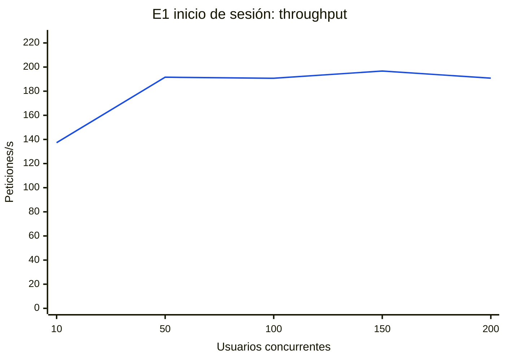
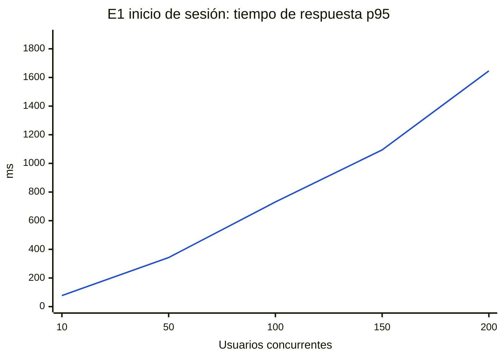
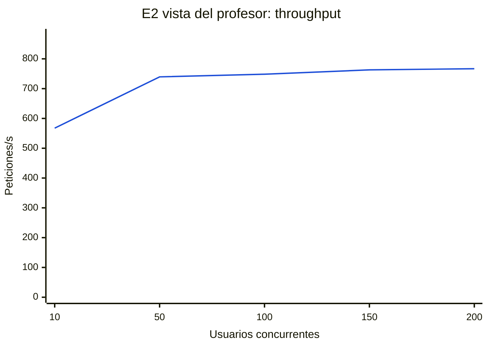
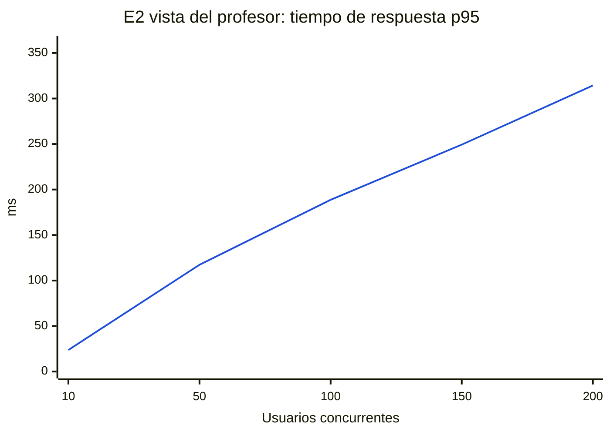
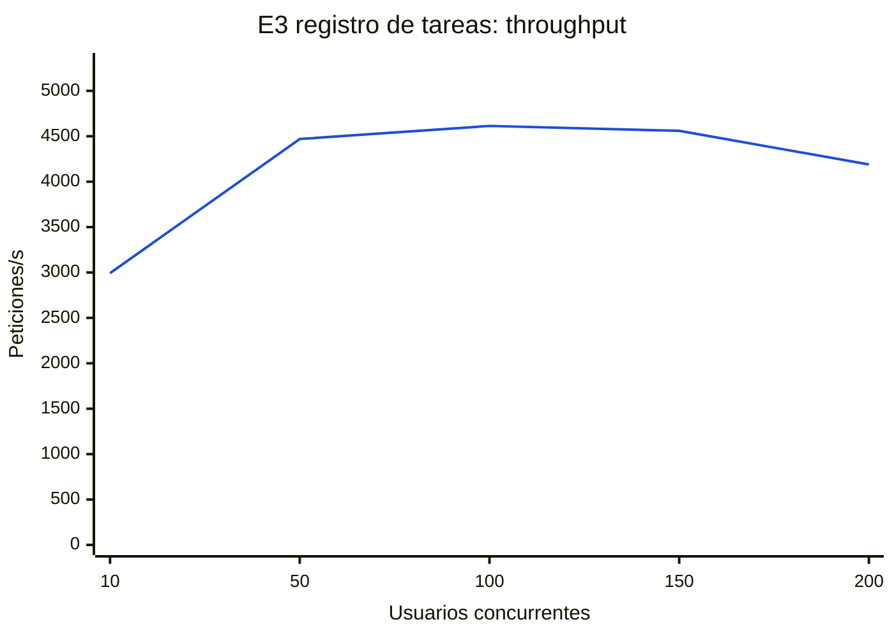
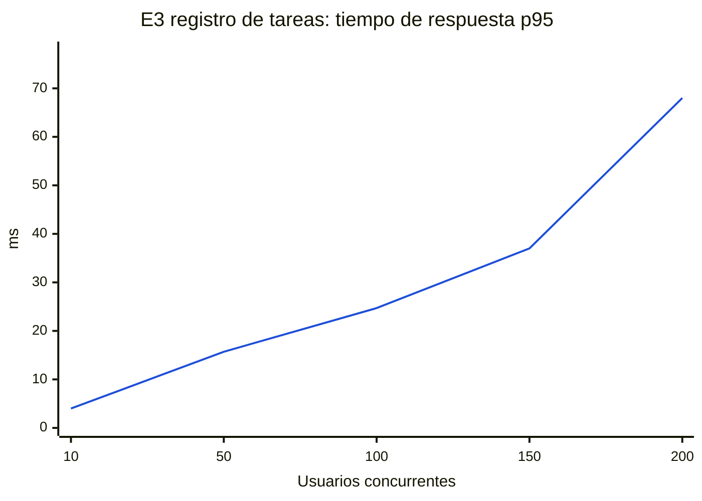

# Entrega 1 – Pruebas de carga y análisis de capacidad

> **Grupo N° _completar_** · _Integrantes_
>
> Línea base de rendimiento del despliegue local (Docker Compose). Sigue la metodología del tutorial *Pruebas de rendimiento: análisis de capacidad* del curso: planeación, ejecución con niveles crecientes de concurrencia, repeticiones y análisis. Los scripts, los datos y los resultados crudos están en la carpeta [`pruebas-carga/`](https://github.com/JuanVargas0325/Prueba/tree/main/pruebas-carga) del repositorio.

## 1. Plan de pruebas

### 1.1 Objetivo

Establecer la **línea base de capacidad** de la API desplegada localmente: cuántas peticiones por segundo y cuántos usuarios concurrentes soporta cada operación representativa antes de degradarse, qué recurso se satura primero y qué decisiones de arquitectura explican ese comportamiento. Esta línea base se comparará con el despliegue en la nube de la Entrega 2.

**Objetivos específicos**

1. Medir throughput, tiempos de respuesta (media y percentiles) y tasa de errores por escenario y nivel de concurrencia.
2. Identificar el punto de saturación de cada escenario y el componente que lo limita (CPU de la API o base de datos).
3. Determinar la capacidad máxima que cumple los criterios de aceptación.

### 1.2 Escenarios

Se eligieron tres operaciones que representan los tres tipos de carga del sistema:

| Escenario | Operación | Tipo de carga | Por qué |
|---|---|---|---|
| **E1** | `POST /api/v1/auth/login` | CPU (verificación bcrypt) | Toda sesión empieza aquí; es la operación más costosa por diseño de seguridad. |
| **E2** | `GET /api/v1/seguimiento/personas` (profesora con 40 personas) | Lectura y agregación | Vista principal del profesor (RF-10.1): consulta vinculaciones y tareas de dos semanas y calcula el estado de cada persona. |
| **E3** | `POST /api/v1/tareas` | Escritura | Operación más frecuente de los monitores: valida reglas y persiste la tarea. |

La generación de reportes con IA no se incluye: es asíncrona y su duración depende del proveedor del modelo, todavía no definido. Se evaluará cuando el modelo esté configurado.

### 1.3 Parámetros de ejecución

| Parámetro | Valor |
|---|---|
| Niveles de concurrencia | 10, 50, 100, 150 y 200 usuarios simultáneos |
| Duración por corrida | 15 segundos (`ab -t 15`), con *keep-alive* |
| Repeticiones por nivel | 3 |
| Total | 3 escenarios × 5 niveles × 3 repeticiones = 45 corridas |
| Pausa entre corridas | 3 segundos |
| Punto de entrada | Nginx (`http://nginx`), igual que un cliente real |

### 1.4 Datos de prueba

`pruebas-carga/datos_carga.sql` crea una profesora con un curso de **40 monitores**, cada uno con **2 tareas por semana durante 10 semanas (800 tareas)**. Representa a un profesor con un curso grande a mitad del semestre. Antes de cada ejecución el script elimina las tareas creadas por ejecuciones anteriores, para que todas partan del mismo estado.

### 1.5 Ambiente de prueba

| Elemento | Detalle |
|---|---|
| Equipo anfitrión | Intel Core 7 240H (10 núcleos, 16 hilos), 15,6 GB de RAM, Windows 11 |
| Virtualización | Docker Desktop 29.8 sobre WSL2, con 16 vCPU y 7,6 GB de RAM para los contenedores |
| Sistema | Despliegue de la Entrega 1 sin modificaciones: Nginx 1.27, API y worker en Go 1.26, PostgreSQL 16 y Redis 7, todos sobre Debian 12 |
| Generador de carga | Apache Benchmark 2.3 (`httpd:2.4-bookworm`) en un contenedor de la misma red de Docker |
| Monitoreo | `docker stats`, una muestra por segundo de CPU y memoria de la API y de PostgreSQL |

### 1.6 Criterios de aceptación

| Escenario | Criterio |
|---|---|
| E1 · Inicio de sesión | p95 ≤ 1.000 ms y 0 % de errores |
| E2 · Vista del profesor | p95 ≤ 500 ms y 0 % de errores |
| E3 · Registro de tareas | p95 ≤ 300 ms y 0 % de errores |

Son valores de referencia para una aplicación interactiva interna. El inicio de sesión admite más tiempo porque ocurre una vez por sesión.

### 1.7 Métricas

Por corrida: peticiones completadas, errores (respuestas no 2xx y fallos de conexión), peticiones por segundo, tiempo medio, percentiles 50, 90, 95 y 99, tiempo máximo, CPU máxima de la API y de la base de datos, y memoria máxima. Las respuestas que `ab` marca como fallidas solo por variar de tamaño (las respuestas JSON cambian de longitud) no se cuentan como errores.

### 1.8 Riesgos y limitaciones

- El generador de carga corre en el **mismo equipo** que el sistema y compite por CPU. Los valores absolutos son conservadores, sobre todo en E1.
- El entorno local (Docker Desktop) no representa la infraestructura de la nube; por eso esta medición es una línea base para comparar, no una predicción de producción.
- No se mide el tráfico de red entre contenedores ni el disco de forma separada.
- El reporte con IA queda fuera hasta definir el proveedor del modelo.

## 2. Resultados

Ejecutado el 11 de octubre de 2026. Cada fila promedia las 3 corridas del nivel (± desviación estándar). Los datos crudos están en `pruebas-carga/resultados/` (`resumen.csv`, salidas de `ab` y muestras de `docker stats`).

**Ninguna de las 45 corridas registró errores** (más de 1,1 millones de peticiones en total).

#### E1 · Inicio de sesión (POST /api/v1/auth/login)

| Concurrencia | Peticiones/s | Media (ms) | p50 (ms) | p95 (ms) | p99 (ms) | Máx (ms) | Errores (%) | CPU API máx (%) | CPU BD máx (%) | Mem API máx (MB) |
|---:|---:|---:|---:|---:|---:|---:|---:|---:|---:|---:|
| 10 | 137.3 ± 0.4 | 72.8 ± 0.2 | 71 | 77 ± 2 | 88 | 108 | 0.00 | 976 | 10 | 33 |
| 50 | 191.6 ± 1.7 | 261.0 ± 2.4 | 252 | 343 ± 2 | 396 | 653 | 0.00 | 1632 | 12 | 31 |
| 100 | 190.7 ± 2.8 | 524.6 ± 7.6 | 499 | 731 ± 30 | 998 | 1927 | 0.00 | 1619 | 13 | 34 |
| 150 | 196.7 ± 0.4 | 762.4 ± 1.4 | 708 | 1094 ± 25 | 2074 | 3091 | 0.00 | 1590 | 11 | 37 |
| 200 | 190.8 ± 5.7 | 1049.1 ± 31.9 | 968 | 1646 ± 141 | 2279 | 3391 | 0.00 | 1610 | 14 | 43 |





#### E2 · Vista principal del profesor (GET /api/v1/seguimiento/personas)

| Concurrencia | Peticiones/s | Media (ms) | p50 (ms) | p95 (ms) | p99 (ms) | Máx (ms) | Errores (%) | CPU API máx (%) | CPU BD máx (%) | Mem API máx (MB) |
|---:|---:|---:|---:|---:|---:|---:|---:|---:|---:|---:|
| 10 | 567.4 ± 6.1 | 17.6 ± 0.2 | 17 | 24 ± 1 | 27 | 69 | 0.00 | 706 | 136 | 47 |
| 50 | 739.5 ± 7.2 | 67.6 ± 0.7 | 64 | 117 ± 1 | 145 | 256 | 0.00 | 882 | 174 | 74 |
| 100 | 748.5 ± 3.5 | 133.6 ± 0.6 | 129 | 189 ± 2 | 219 | 302 | 0.00 | 868 | 169 | 84 |
| 150 | 762.9 ± 4.4 | 196.6 ± 1.1 | 192 | 249 ± 2 | 279 | 423 | 0.00 | 896 | 173 | 82 |
| 200 | 766.9 ± 14.3 | 260.9 ± 4.9 | 255 | 314 ± 7 | 348 | 499 | 0.00 | 898 | 172 | 84 |





#### E3 · Registro de tareas (POST /api/v1/tareas)

| Concurrencia | Peticiones/s | Media (ms) | p50 (ms) | p95 (ms) | p99 (ms) | Máx (ms) | Errores (%) | CPU API máx (%) | CPU BD máx (%) | Mem API máx (MB) |
|---:|---:|---:|---:|---:|---:|---:|---:|---:|---:|---:|
| 10 | 2992.6 ± 26.5 | 3.3 ± 0.0 | 3 | 4 ± 0 | 5 | 20 | 0.00 | 294 | 230 | 30 |
| 50 | 4469.7 ± 299.9 | 11.2 ± 0.8 | 11 | 16 ± 5 | 19 | 42 | 0.00 | 423 | 345 | 36 |
| 100 | 4613.8 ± 20.5 | 21.7 ± 0.1 | 21 | 25 ± 1 | 29 | 66 | 0.00 | 415 | 345 | 41 |
| 150 | 4559.9 ± 2.9 | 32.9 ± 0.0 | 32 | 37 ± 0 | 51 | 113 | 0.00 | 416 | 347 | 47 |
| 200 | 4190.0 ± 221.4 | 47.8 ± 2.5 | 44 | 68 ± 19 | 94 | 250 | 0.00 | 424 | 352 | 45 |





## 3. Análisis

### E1 · Inicio de sesión: limitado por CPU

El throughput sube de 137 a unas **190 peticiones/s con 50 usuarios y no crece más**: desde ese nivel la API usa toda la CPU disponible (~1.600 %, los 16 vCPU). Cada inicio de sesión verifica la contraseña con **bcrypt**, un algoritmo diseñado para ser costoso y frenar ataques de fuerza bruta. Por eso la operación está limitada por CPU y no por la base de datos, que no supera el 14 % de CPU.

Una vez saturada la CPU, los tiempos crecen linealmente con la concurrencia, como predice la ley de Little: con 200 usuarios y 191 peticiones/s, cada petición espera en promedio ≈ 200 / 191 ≈ 1,05 s, que coincide con la media medida (1.049 ms). La desviación entre repeticiones es baja (< 3 % en throughput), así que el comportamiento es consistente.

### E2 · Vista del profesor: limitado por la base de datos y el cálculo por consulta

El throughput se estabiliza en unas **750 peticiones/s desde 50 usuarios**, aunque la API usa ~880 % de CPU (de 1.600 % disponibles) y PostgreSQL ~170 %. Que ningún recurso llegue al 100 % mientras el throughput se aplana indica una **espera**: la hipótesis principal es el pool de conexiones a PostgreSQL (16 conexiones, el valor por defecto de pgx para 16 CPU) junto con el costo de cada consulta, que lee las vinculaciones y todas las tareas de dos semanas para calcular el estado en memoria (DT-08). Los tiempos crecen linealmente después de la saturación, también según la ley de Little.

**Observación adicional:** en una corrida de validación previa, con unas 3.000 tareas adicionales en la semana actual, este escenario cayó a **51 peticiones/s y 196 ms de media con solo 10 usuarios**, frente a 567 peticiones/s y 18 ms en condiciones normales. El costo de la vista crece con el volumen de tareas del período consultado, porque se traen todas las filas para agregarlas en la aplicación. Es la mejora de rendimiento más importante para las siguientes entregas.

### E3 · Registro de tareas: el escenario más eficiente

Alcanza unas **4.600 peticiones/s con 100 usuarios** con un p95 de 25 ms. Es una escritura simple: valida la vinculación, aplica las reglas y hace un INSERT. Con 200 usuarios el throughput baja a ~4.190 peticiones/s y aumenta la variabilidad (p95 de 68 ± 19 ms). Coincide con el crecimiento de la tabla durante la prueba (cada corrida inserta ~62.000 tareas) y con la contención en las escrituras de PostgreSQL, cuya CPU se mantiene en ~350 %.

### Uso de memoria

La API usa menos de 90 MB en todos los escenarios y PostgreSQL menos de 260 MB (este último crece en E3 por las inserciones). La memoria no es una restricción en ningún caso.

## 4. Capacidad máxima y conclusiones

| Escenario | Throughput máximo | Concurrencia máxima que cumple el criterio | Recurso limitante |
|---|---|---|---|
| E1 · Inicio de sesión | ~190 peticiones/s | **100 usuarios** (p95 = 731 ms ≤ 1.000 ms; con 150 ya son 1.094 ms) | CPU de la API (bcrypt) |
| E2 · Vista del profesor | ~765 peticiones/s | **≥ 200 usuarios** (p95 = 314 ms ≤ 500 ms) | Conexiones a la BD y cálculo por consulta (hipótesis) |
| E3 · Registro de tareas | ~4.600 peticiones/s | **≥ 200 usuarios** (p95 = 68 ms ≤ 300 ms) | Escrituras en PostgreSQL |

Para la escala esperada (profesores con decenas de personas que registran tareas varias veces por semana), el despliegue local cumple holgadamente: incluso el escenario más costoso soporta unos 190 inicios de sesión por segundo.

**Relación con las decisiones de arquitectura y siguientes pasos**

1. **bcrypt (E1):** el costo es intencional y no se reducirá. Para más capacidad, la API debe escalar horizontalmente; como no guarda estado en memoria (sesiones con JWT), varias instancias detrás de un balanceador (Entrega 3) multiplican la capacidad de E1 casi linealmente. El límite de intentos de inicio de sesión (DT-05) además protege este recurso.
2. **Vista del profesor (E2):** confirma la deuda DT-08. Opciones a evaluar en la Entrega 2: agregar en SQL (sumar horas y contar tareas por persona y semana sin traer cada fila) y medir el pool de conexiones (`pool_max_conns`) frente a la CPU disponible en la máquina virtual de GCP.
3. **Escrituras (E3):** no son una restricción. En la Entrega 2, con Cloud SQL, habrá que observar la latencia de red entre la máquina virtual y la base de datos, que hoy es prácticamente cero.
4. **Comparación:** esta es la primera medición (no hay iteración previa). La Entrega 2 repetirá exactamente estos escenarios y parámetros en GCP para comparar.

## 5. Cómo reproducir

```bash
docker compose up -d --wait
docker compose exec -T postgres psql -U seguimiento -d seguimiento < pruebas-carga/datos_carga.sql
bash pruebas-carga/ejecutar.sh        # ~17 minutos
python pruebas-carga/analizar.py      # tablas y gráficas en pruebas-carga/resultados/resumen.md
```

Se pueden ajustar `NIVELES`, `REPETICIONES`, `DURACION` y `ESCENARIOS` con variables de entorno (ver el encabezado de `ejecutar.sh`).
