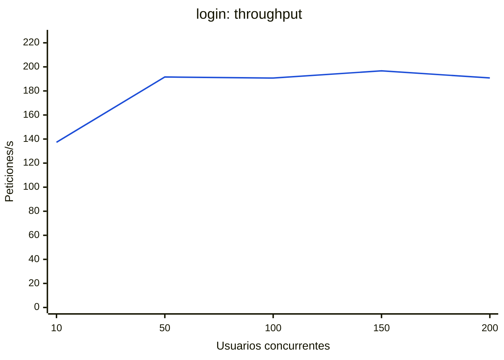
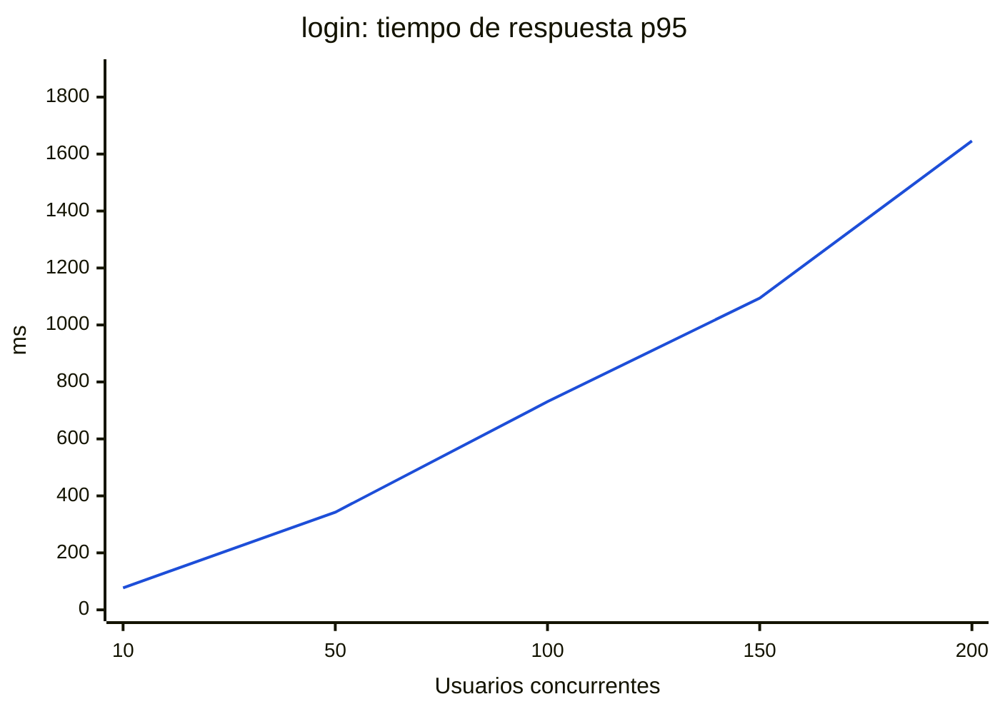
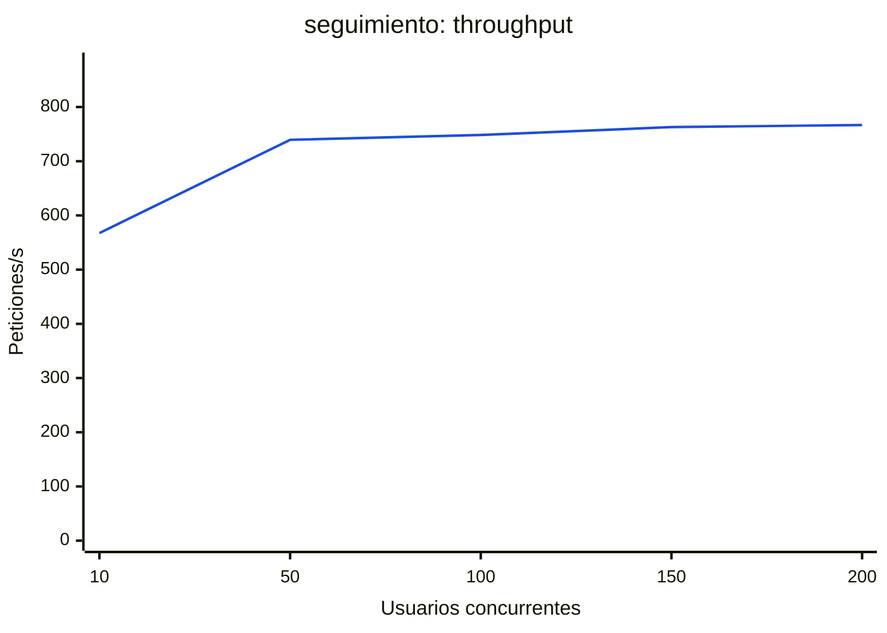
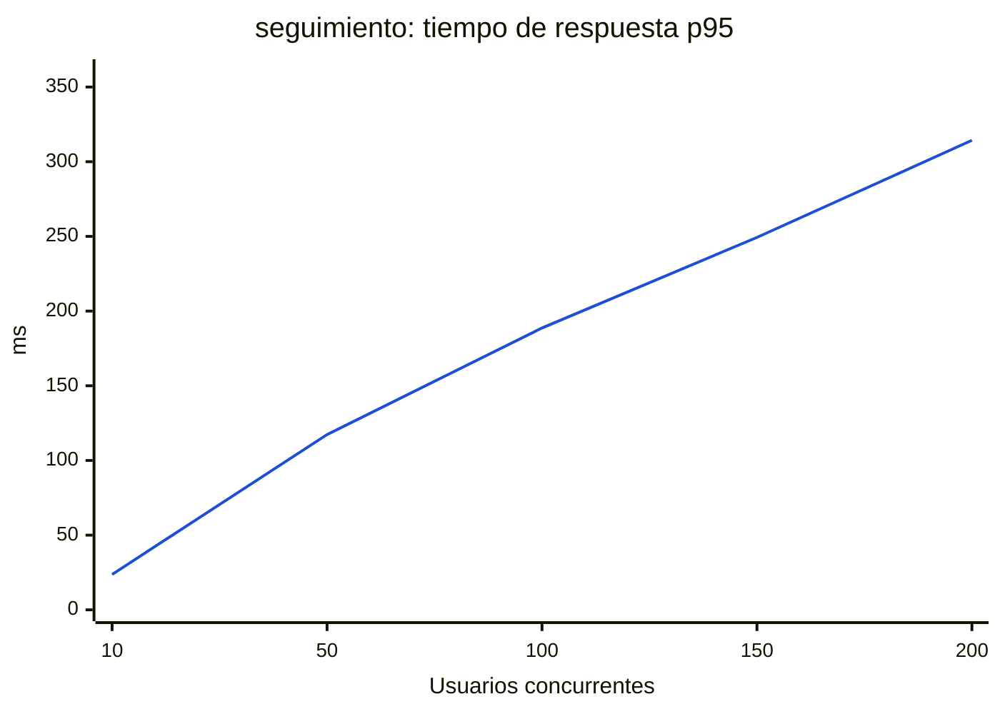
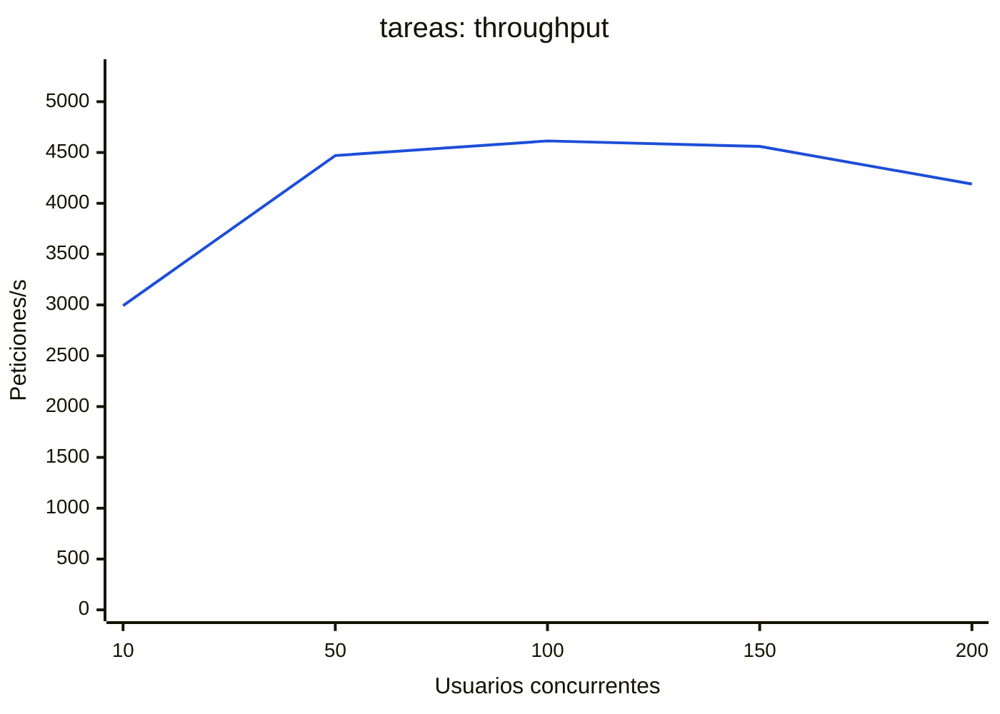
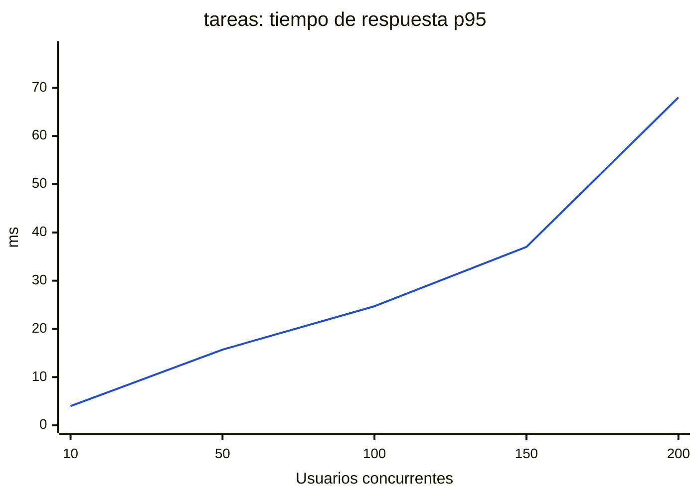

#### E1 · Inicio de sesión (POST /api/v1/auth/login)

| Concurrencia | Peticiones/s | Media (ms) | p50 (ms) | p95 (ms) | p99 (ms) | Máx (ms) | Errores (%) | CPU API máx (%) | CPU BD máx (%) | Mem API máx (MB) |
|---:|---:|---:|---:|---:|---:|---:|---:|---:|---:|---:|
| 10 | 137.3 ± 0.4 | 72.8 ± 0.2 | 71 | 77 ± 2 | 88 | 108 | 0.00 | 976 | 10 | 33 |
| 50 | 191.6 ± 1.7 | 261.0 ± 2.4 | 252 | 343 ± 2 | 396 | 653 | 0.00 | 1632 | 12 | 31 |
| 100 | 190.7 ± 2.8 | 524.6 ± 7.6 | 499 | 731 ± 30 | 998 | 1927 | 0.00 | 1619 | 13 | 34 |
| 150 | 196.7 ± 0.4 | 762.4 ± 1.4 | 708 | 1094 ± 25 | 2074 | 3091 | 0.00 | 1590 | 11 | 37 |
| 200 | 190.8 ± 5.7 | 1049.1 ± 31.9 | 968 | 1646 ± 141 | 2279 | 3391 | 0.00 | 1610 | 14 | 43 |

Cada fila promedia 3 corridas (± desviación estándar).

#### E2 · Vista principal del profesor (GET /api/v1/seguimiento/personas)

| Concurrencia | Peticiones/s | Media (ms) | p50 (ms) | p95 (ms) | p99 (ms) | Máx (ms) | Errores (%) | CPU API máx (%) | CPU BD máx (%) | Mem API máx (MB) |
|---:|---:|---:|---:|---:|---:|---:|---:|---:|---:|---:|
| 10 | 567.4 ± 6.1 | 17.6 ± 0.2 | 17 | 24 ± 1 | 27 | 69 | 0.00 | 706 | 136 | 47 |
| 50 | 739.5 ± 7.2 | 67.6 ± 0.7 | 64 | 117 ± 1 | 145 | 256 | 0.00 | 882 | 174 | 74 |
| 100 | 748.5 ± 3.5 | 133.6 ± 0.6 | 129 | 189 ± 2 | 219 | 302 | 0.00 | 868 | 169 | 84 |
| 150 | 762.9 ± 4.4 | 196.6 ± 1.1 | 192 | 249 ± 2 | 279 | 423 | 0.00 | 896 | 173 | 82 |
| 200 | 766.9 ± 14.3 | 260.9 ± 4.9 | 255 | 314 ± 7 | 348 | 499 | 0.00 | 898 | 172 | 84 |

Cada fila promedia 3 corridas (± desviación estándar).

#### E3 · Registro de tareas (POST /api/v1/tareas)

| Concurrencia | Peticiones/s | Media (ms) | p50 (ms) | p95 (ms) | p99 (ms) | Máx (ms) | Errores (%) | CPU API máx (%) | CPU BD máx (%) | Mem API máx (MB) |
|---:|---:|---:|---:|---:|---:|---:|---:|---:|---:|---:|
| 10 | 2992.6 ± 26.5 | 3.3 ± 0.0 | 3 | 4 ± 0 | 5 | 20 | 0.00 | 294 | 230 | 30 |
| 50 | 4469.7 ± 299.9 | 11.2 ± 0.8 | 11 | 16 ± 5 | 19 | 42 | 0.00 | 423 | 345 | 36 |
| 100 | 4613.8 ± 20.5 | 21.7 ± 0.1 | 21 | 25 ± 1 | 29 | 66 | 0.00 | 415 | 345 | 41 |
| 150 | 4559.9 ± 2.9 | 32.9 ± 0.0 | 32 | 37 ± 0 | 51 | 113 | 0.00 | 416 | 347 | 47 |
| 200 | 4190.0 ± 221.4 | 47.8 ± 2.5 | 44 | 68 ± 19 | 94 | 250 | 0.00 | 424 | 352 | 45 |

Cada fila promedia 3 corridas (± desviación estándar).

