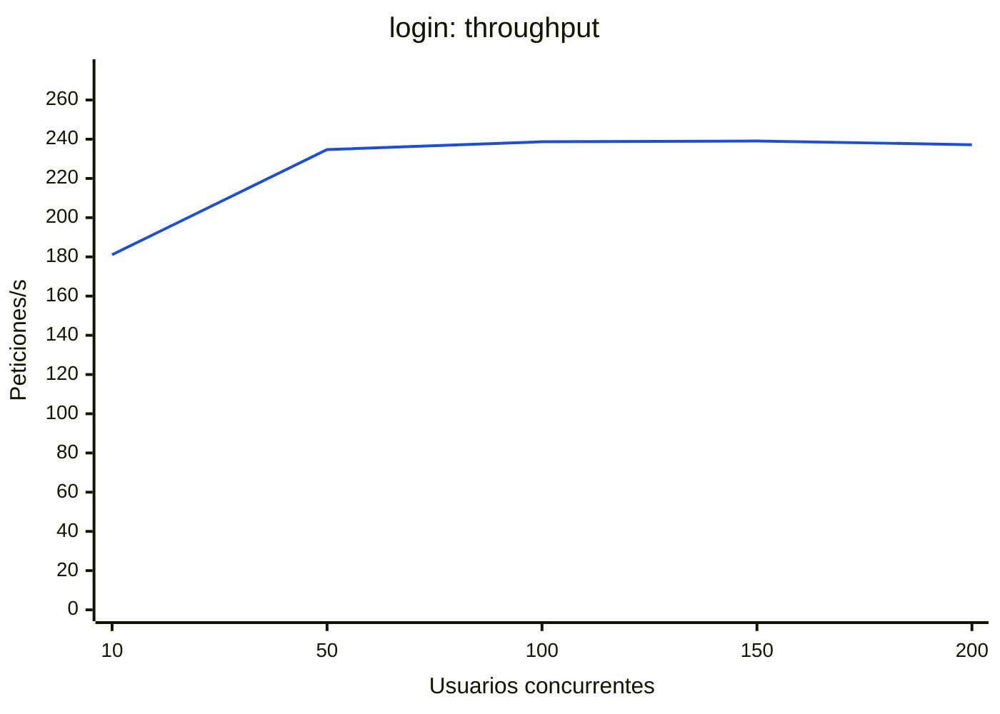
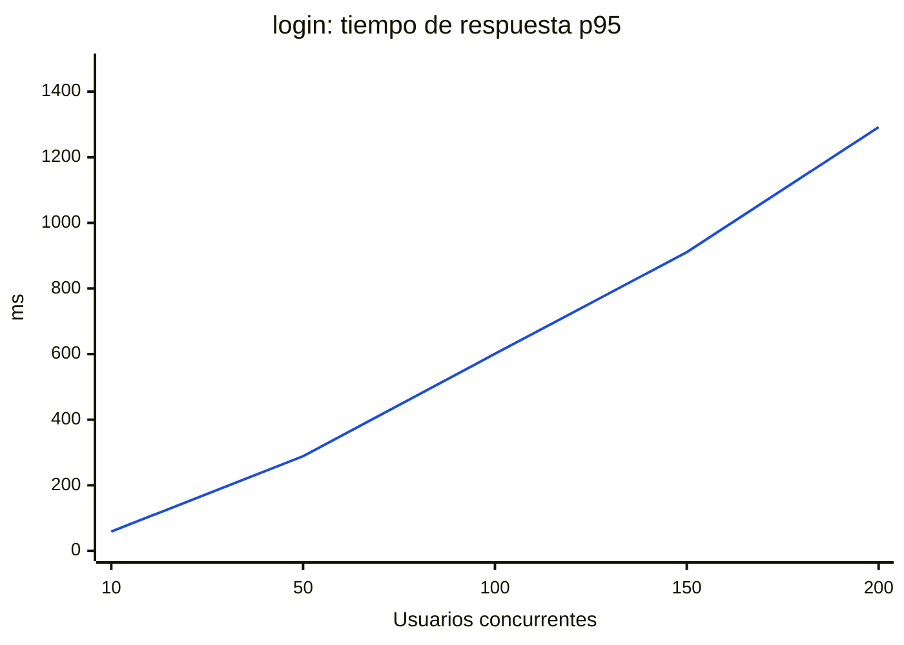
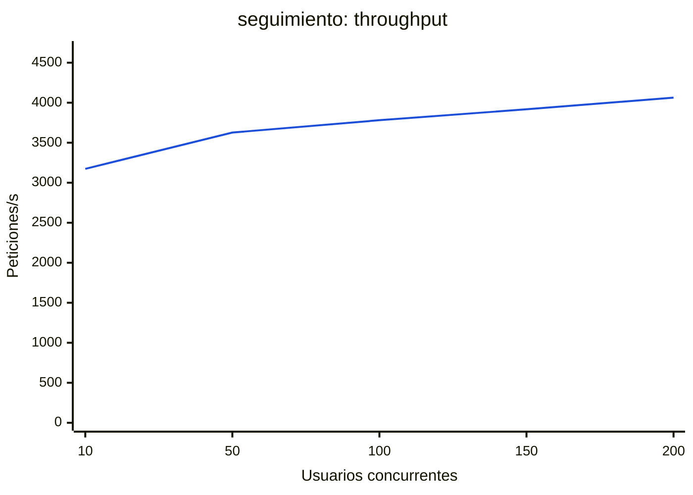
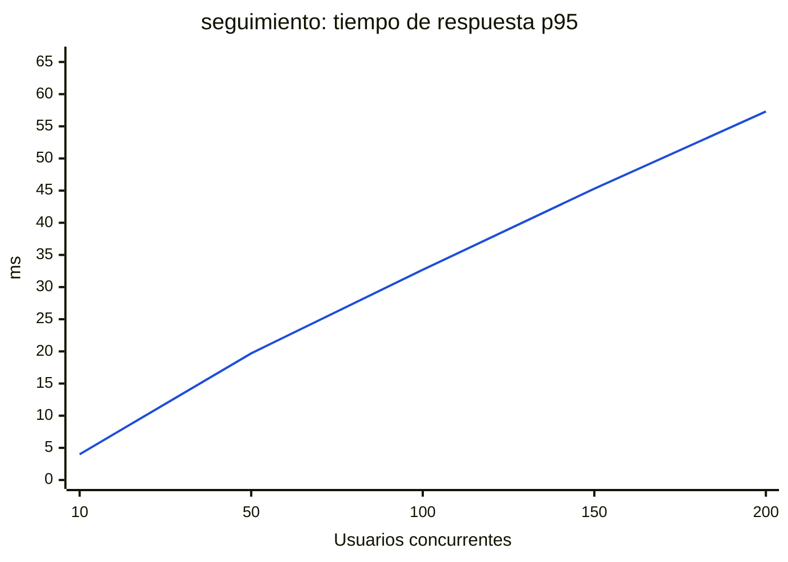
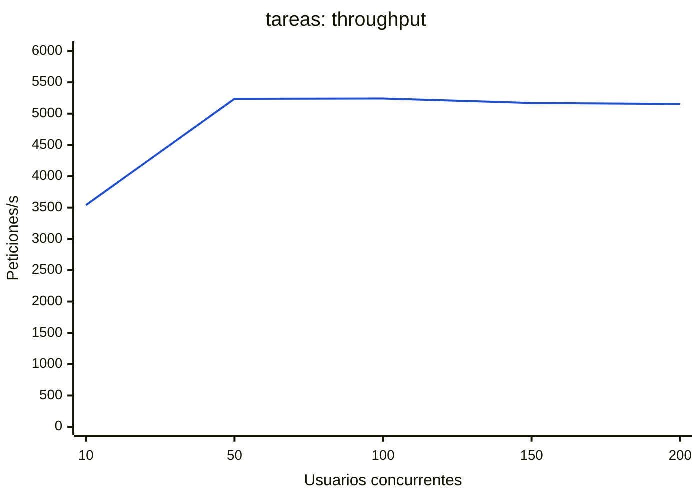
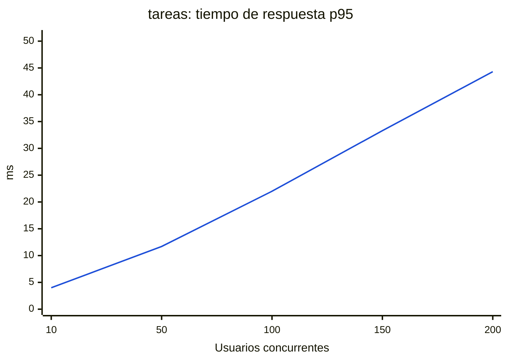

#### E1 · Inicio de sesión (POST /api/v1/auth/login)

| Concurrencia | Peticiones/s | Media (ms) | p50 (ms) | p95 (ms) | p99 (ms) | Máx (ms) | Errores (%) | CPU API máx (%) | CPU BD máx (%) | Mem API máx (MB) |
|---:|---:|---:|---:|---:|---:|---:|---:|---:|---:|---:|
| 10 | 181.1 ± 4.4 | 55.2 ± 1.3 | 55 | 59 ± 1 | 64 | 79 | 0.00 | 971 | 9 | 18 |
| 50 | 234.7 ± 15.2 | 213.7 ± 14.3 | 207 | 289 ± 26 | 339 | 896 | 0.00 | 1603 | 11 | 21 |
| 100 | 238.7 ± 0.2 | 419.0 ± 0.3 | 400 | 601 ± 12 | 809 | 1281 | 0.00 | 1583 | 10 | 28 |
| 150 | 239.1 ± 0.6 | 627.2 ± 1.6 | 588 | 911 ± 16 | 1171 | 1626 | 0.00 | 1581 | 10 | 29 |
| 200 | 237.2 ± 1.1 | 843.1 ± 4.0 | 783 | 1292 ± 145 | 1864 | 3219 | 0.00 | 1591 | 9 | 33 |

Cada fila promedia 3 corridas (± desviación estándar).

#### E2 · Vista principal del profesor (GET /api/v1/seguimiento/personas)

| Concurrencia | Peticiones/s | Media (ms) | p50 (ms) | p95 (ms) | p99 (ms) | Máx (ms) | Errores (%) | CPU API máx (%) | CPU BD máx (%) | Mem API máx (MB) |
|---:|---:|---:|---:|---:|---:|---:|---:|---:|---:|---:|
| 10 | 3173.5 ± 60.1 | 3.2 ± 0.1 | 3 | 4 ± 0 | 5 | 11 | 0.00 | 558 | 222 | 35 |
| 50 | 3627.0 ± 32.1 | 13.8 ± 0.1 | 13 | 20 ± 1 | 23 | 50 | 0.00 | 660 | 268 | 45 |
| 100 | 3781.3 ± 7.1 | 26.4 ± 0.0 | 26 | 33 ± 1 | 37 | 57 | 0.00 | 670 | 282 | 48 |
| 150 | 3917.7 ± 18.1 | 38.3 ± 0.2 | 38 | 45 ± 1 | 50 | 65 | 0.00 | 679 | 299 | 53 |
| 200 | 4062.9 ± 9.8 | 49.2 ± 0.1 | 48 | 57 ± 1 | 63 | 80 | 0.00 | 693 | 316 | 58 |

Cada fila promedia 3 corridas (± desviación estándar).

#### E3 · Registro de tareas (POST /api/v1/tareas)

| Concurrencia | Peticiones/s | Media (ms) | p50 (ms) | p95 (ms) | p99 (ms) | Máx (ms) | Errores (%) | CPU API máx (%) | CPU BD máx (%) | Mem API máx (MB) |
|---:|---:|---:|---:|---:|---:|---:|---:|---:|---:|---:|
| 10 | 3540.1 ± 27.6 | 2.8 ± 0.0 | 3 | 4 ± 0 | 4 | 16 | 0.00 | 281 | 210 | 34 |
| 50 | 5237.0 ± 41.8 | 9.5 ± 0.1 | 9 | 12 ± 1 | 13 | 27 | 0.00 | 409 | 336 | 31 |
| 100 | 5242.2 ± 15.2 | 19.1 ± 0.1 | 19 | 22 ± 0 | 26 | 41 | 0.00 | 413 | 346 | 36 |
| 150 | 5169.9 ± 42.3 | 29.0 ± 0.2 | 28 | 33 ± 1 | 40 | 94 | 0.00 | 410 | 349 | 41 |
| 200 | 5153.3 ± 74.9 | 38.8 ± 0.6 | 38 | 44 ± 2 | 50 | 88 | 0.00 | 419 | 349 | 40 |

Cada fila promedia 3 corridas (± desviación estándar).

